# Лабораторная работа №4. Спецификация варианта использования

| | |
|---|---|
| **Кейс** | Система управления программой лояльности сети фитнес-клубов «Fitness & Health» |
| **Учебник** | Галиаскаров Э.Г., Воробьёв А.С. «Анализ и проектирование систем с использованием UML», гл. 4 |
| **Теория** | Лекция 7 «Бизнес-правила и карта User Story»; материалы GetAnalyst (обычные и интеграционные Use Cases, типовые ошибки интеграций) |
| **Инструмент** | Visual Paradigm 18.1 |
| **Автор** | Белянкин Артемий Русланович, БИ 3-3 |

> ЛР4 отвечает на вопрос **«как именно»**: каждый выбранный вариант использования превращается в пошаговый диалог действующего лица и системы, пригодный для передачи разработчику и тестировщику.

---

## 1. Общие сведения

### 1.1. Цель и задачи работы

**Цель работы:** составить подробные спецификации вариантов использования с наивысшим приоритетом и представить их в графическом виде - диаграммами деятельности.

**Задачи работы:**
1. Проанализировать список из 33 вариантов использования и расставить приоритеты.
2. Выбрать варианты использования для детальной проработки и обосновать выбор.
3. Выделить бизнес-правила предметной области в отдельный каталог.
4. Составить спецификации выбранных вариантов использования по единому шаблону.
5. Связать каждый вариант использования с пользовательской историей и критериями приёмки.
6. Построить диаграммы деятельности, соответствующие описаниям потоков событий.

### 1.2. Шаблон спецификации

За основу взят шаблон учебника (гл. 4). К нему добавлены три поля, которых требует чек-лист практикума и лекция 7:

| Поле | Источник | Назначение |
|---|---|---|
| Имя варианта использования | учебник | Глагольная фраза, уникальный идентификатор в модели ВИ |
| ID | учебник | Суррогатный идентификатор для ссылок (`UC03`) |
| Краткое описание | учебник | Суть варианта использования, не более абзаца |
| Действующие лица | учебник | Основное (инициирует) и второстепенные |
| Предусловия | учебник | Состояние системы, при котором запуск возможен |
| **Стартовое событие** | чек-лист 3.10 | Конкретное событие, с которого начинается сценарий |
| Постусловия | учебник | Что истинно после завершения - для успеха и для неуспеха |
| Основной поток | учебник | «Идеальный» ход событий без ошибок и ответвлений |
| Альтернативные потоки | учебник | Ветвления, повторения и исключения |
| **Бизнес-правила** | лекция 7 | Ссылки на каталог `BR-xxx` вместо дублирования логики в шагах |
| **User Story и критерии приёмки** | чек-лист 3.20, лекция 7 | Связь требования с пользовательской ценностью |

**Правила записи шагов** (учебник, чек-лист 3.13–3.18):
- шаблон шага - `<номер> <кто-либо> <совершает некоторое действие>`;
- первый шаг основного потока - `1. ВИ начинается, когда <действующее лицо> <действие>`;
- каждый шаг - простое предложение, начинающееся с подлежащего: либо действующее лицо, либо система;
- сценарий - диалог: на каждое действие действующего лица следует отклик системы;
- показывается намерение, а не движение: «вводит телефон и пароль», а не «нажимает на поле ввода»;
- каждый шаг продвигает процесс к цели.

**Нумерация альтернативных потоков:** цифра - номер шага основного потока, на котором происходит переключение; буква различает несколько альтернатив одного шага (`4А`, `4Б`). Если переход возможен на нескольких подряд идущих шагах, номера указываются через дефис (`2-4А`).

> Редактор `Flow of Events` в Visual Paradigm нумерует расширения латиницей - `4.a`, `4.b`. Это та же нумерация, что `4А` и `4Б` в текстовой спецификации: цифра указывает шаг основного потока, буква различает расширения на одном шаге.

> Закрывающая фраза «вариант использования завершается» не оформляется отдельным шагом основного потока: она не имеет подлежащего и нарушила бы критерий 3.13. Завершение фиксируется постусловиями, а в модели - управляющим элементом `exit` в альтернативных потоках.

---

## 2. Приоритизация вариантов использования

### 2.1. Критерии

Приоритет считается как сумма трёх оценок по шкале 1–3:

| Критерий | 1 | 2 | 3 |
|---|---|---|---|
| **Ц** - ценность | вспомогательная функция | полезна, но заменима | без неё программа лояльности не работает |
| **Ч** - частота | эпизодически | регулярно | при каждом визите / ежедневно |
| **Р** - риск и сложность | простой CRUD | логика внутри системы | деньги, внешние системы, сложные правила |

Итог: **7–9 - высокий**, **5–6 - средний**, **3–4 - низкий**.

Критерий **Р** включён сознательно: подробная спецификация ценнее всего там, где высока цена ошибки. Простой CRUD разработчик реализует и без детального сценария, а сценарий с деньгами и внешней системой без спецификации порождает поток вопросов на этапе разработки.

### 2.2. Таблица приоритетов

| ID | Вариант использования | Актор | Ц | Ч | Р | Σ | Приоритет |
|---|---|---|:-:|:-:|:-:|:-:|---|
| UC01 | Создать учётную запись | Посетитель | 3 | 2 | 2 | 7 | высокий |
| UC02 | Просмотреть статьи | Посетитель | 1 | 2 | 1 | 4 | низкий |
| **UC03** | **Войти в систему** | Участник программы | 3 | 3 | 1 | 7 | **высокий ✔** |
| UC04 | Выйти из системы | Участник программы | 1 | 2 | 1 | 4 | низкий |
| UC05 | Изменить данные учётной записи | Участник программы | 2 | 1 | 1 | 4 | низкий |
| UC06 | Добавить клубную карту | Участник программы | 2 | 1 | 2 | 5 | средний |
| UC07 | Заблокировать клубную карту | Участник программы | 2 | 1 | 1 | 4 | низкий |
| **UC08** | **Пополнить баланс карты** | Участник программы | 3 | 3 | 3 | 9 | **высокий ✔** |
| UC09 | Просмотреть историю операций | Участник программы | 2 | 2 | 1 | 5 | средний |
| UC10 | Просмотреть количество баллов | Участник программы | 2 | 3 | 1 | 6 | средний |
| UC11 | Просмотреть список вознаграждений | Участник программы | 2 | 2 | 1 | 5 | средний |
| UC12 | Активировать вознаграждение | Участник программы | 3 | 2 | 2 | 7 | высокий |
| UC13 | Просмотреть расписание тренировок | Участник программы | 2 | 3 | 1 | 6 | средний |
| UC14 | Забронировать тренировку | Участник программы | 3 | 3 | 2 | 8 | высокий |
| **UC15** | **Отменить бронирование** | Участник программы | 3 | 2 | 3 | 8 | **высокий ✔** |
| UC16 | Подключить фитнес-трекер | Участник программы | 2 | 1 | 3 | 6 | средний |
| UC17 | Завести правило начисления | Менеджер платформы | 3 | 1 | 3 | 7 | высокий |
| UC18 | Изменить правило начисления | Менеджер платформы | 2 | 1 | 2 | 5 | средний |
| UC19 | Добавить вид вознаграждения | Менеджер платформы | 2 | 1 | 1 | 4 | низкий |
| UC20 | Изменить вид вознаграждения | Менеджер платформы | 2 | 1 | 1 | 4 | низкий |
| UC21 | Опубликовать статью | Менеджер платформы | 1 | 2 | 1 | 4 | низкий |
| UC22 | Изменить статью | Менеджер платформы | 1 | 1 | 1 | 3 | низкий |
| UC23 | Удалить статью | Менеджер платформы | 1 | 1 | 1 | 3 | низкий |
| UC24 | Изменить данные УЗ нарушителя | Менеджер платформы | 1 | 1 | 2 | 4 | низкий |
| UC25 | Заблокировать УЗ | Менеджер платформы | 2 | 1 | 1 | 4 | низкий |
| UC26 | Добавить тренировку в расписание | Менеджер платформы | 2 | 2 | 1 | 5 | средний |
| UC27 | Отменить тренировку | Менеджер платформы | 2 | 1 | 2 | 5 | средний |
| UC28 | Назначить тренера | Менеджер платформы | 1 | 1 | 1 | 3 | низкий |
| UC29 | Провести платёж | Платёжный шлюз | 3 | 3 | 3 | 9 | высокий |
| UC30 | Передать сведения об оплате услуги | Фискальная система клуба | 3 | 3 | 3 | 9 | высокий |
| UC31 | Передать сведения об использованном вознаграждении | Фискальная система клуба | 2 | 2 | 3 | 7 | высокий |
| **UC32** | **Передать данные о шагах** | Фитнес-трекер | 2 | 3 | 3 | 8 | **высокий ✔** |
| UC33 | Начислить вознаграждение по дате | Время | 2 | 1 | 2 | 5 | средний |

### 2.3. Выбранные варианты использования

Для детальной проработки выбраны четыре варианта использования - так, чтобы покрыть все характерные типы сценариев модели:

| ID | Вариант использования | Что он демонстрирует |
|---|---|---|
| UC03 | Войти в систему | Базовый сценарий. Является предусловием почти всех остальных ВИ участника программы. Простая структура - эталон оформления |
| UC08 | Пополнить баланс карты | Денежный путь. Взаимодействие с внешней системой, ветвление по сумме, самая высокая цена ошибки |
| UC15 | Отменить бронирование | Самая насыщенная бизнес-логика кейса: правило двух часов, штраф, блокировка записи |
| UC32 | Передать данные о шагах | Полностью интеграционный ВИ: пользователь в сценарии не участвует, инициатор - внешняя система |

**Почему UC29 «Провести платёж» не специфицируется отдельно.** UC29 - интеграционный ВИ платёжного шлюза, который целиком раскрывается внутри основного потока UC08 (шаги 8–9) и его альтернатив. Отдельная спецификация продублировала бы те же шаги и создала бы вторую точку правки при изменении логики. Это соответствует требованию чек-листа 3.21 «минимизировано количество цепочек действий с зависимостями». По той же причине не выделяется отдельно UC30 - он будет раскрыт при проработке сценария начисления баллов.

---

## 3. Каталог бизнес-правил

Бизнес-правила вынесены из текстов сценариев в отдельный каталог: одно правило живёт в одном месте, а шаги вариантов использования ссылаются на него по идентификатору. Формат каталога - по лекции 7 (слайды 10–11).

| ID | Определение правила | Тип | Статичное / динамичное | Источник |
|---|---|---|---|---|
| **BR-001** | За каждые полные 100 ₽, потраченные на услуги клуба по клубной карте, участнику начисляется 1 фитнес-балл | Вычисление | Динамичное | Правила программы лояльности |
| **BR-002** | Если оплата услуги совершена в день рождения участника, количество начисляемых баллов удваивается | Активатор операций | Динамичное | Правила программы лояльности |
| **BR-003** | Оплаты, совершённые без клубной карты, в программе лояльности не учитываются | Ограничение | Статичное | Правила программы лояльности |
| **BR-004** | Баллы участника суммируются по всем его клубным картам и расходуются независимо от того, какой картой накоплены | Факт | Статичное | Правила программы лояльности |
| **BR-005** | Вознаграждения обмениваются на баллы по шкале: 100 - «Скидка 10% на разовое занятие», 250 - «Бесплатное занятие с любым тренером», 500 - «Фирменная бутылка для воды», 1000 - «Скидка 50% на покупку абонемента на месяц» | Вычисление | Динамичное | Каталог вознаграждений |
| **BR-006** | Вознаграждение «Фирменный гостевой пропуск» начисляется участнику ежегодно в день его рождения | Активатор операций | Динамичное | Маркетинговая политика |
| **BR-007** | Вознаграждение «Фитнес-бонус» в размере 50 баллов начисляется после каждого пополнения клубной карты на сумму, превышающую 5000 ₽ | Активатор операций | Динамичное | Маркетинговая политика |
| **BR-008** | Пополнение возможно только для клубной карты, зарегистрированной за участником и не заблокированной | Ограничение | Статичное | Правила обслуживания карт |
| **BR-009** | Баланс средств на клубной карте не может быть отрицательным | Ограничение | Статичное | Правила обслуживания карт |
| **BR-010** | Два разных участника не могут использовать клубную карту с одним и тем же номером | Ограничение | Статичное | Правила обслуживания карт |
| **BR-011** | При активации вознаграждения количество накопленных баллов уменьшается на стоимость выбранного вида вознаграждения, а система генерирует уникальный QR-код | Активатор операций | Статичное | Правила программы лояльности |
| **BR-012** | Отмена бронирования без последствий возможна не позднее чем за 2 часа до начала тренировки | Ограничение | Динамичное | Правила посещения клуба |
| **BR-013** | При отмене бронирования позднее чем за 2 часа до начала тренировки с участника взимается штраф в размере 20% от стоимости занятия; если средств на клубной карте недостаточно, участнику блокируется возможность записи на сутки | Активатор операций | Динамичное | Правила посещения клуба |
| **BR-014** | Забронировать платную тренировку можно при достаточном балансе клубной карты либо при наличии вознаграждения на бесплатное занятие, и при наличии свободных мест | Ограничение | Статичное | Правила посещения клуба |
| **BR-015** | За каждые полные 10 000 шагов в сутки, подтверждённых через интеграцию с фитнес-трекером, начисляется 1 фитнес-балл, но не более 3 баллов в сутки | Вычисление | Динамичное | Правила программы лояльности |
| **BR-016** | Если участник проходит 15 000 шагов в день пять дней подряд, ему начисляется вознаграждение «Бонусная тренировка» | Активатор операций | Динамичное | Маркетинговая политика |

> Правила `BR-009` и `BR-010` уже формализованы в ЛР3 как OCL-инварианты модели классов. Правила `BR-001`, `BR-005`, `BR-007`, `BR-015` соответствуют классам-наследникам `Правило по операции`, `Правило по дате` и `Правило по активности` - то есть каталог бизнес-правил и модель классов согласованы между собой.

### 3.1. Допущения

Текст кейса в двух местах допускает разночтения. Решения зафиксированы здесь явно, чтобы спецификация не содержала скрытых трактовок:

| № | Место в кейсе | Разночтение | Принятое решение |
|---|---|---|---|
| 1 | «списывается штраф в размере 20% от стоимости занятия **или** блокируется на сутки возможность записи» | Не указано, кто и по какому признаку выбирает между штрафом и блокировкой | Основной способ - штраф. Блокировка применяется только если на клубной карте недостаточно средств для списания штрафа: иначе правило нарушало бы `BR-009`. Зафиксировано в `BR-013` |
| 2 | «Вознаграждение “Фитнес-бонус” в размере 50 баллов» | В модели классов `Вознаграждение` - объект с видом и QR-кодом, а «Фитнес-бонус» фактически является начислением баллов | «Фитнес-бонус» трактуется как начисление 50 фитнес-баллов участнику, а не как объект класса `Вознаграждение`. В постусловии UC08 формулируется именно так |

---

## 4. Спецификации вариантов использования

### 4.1. UC03 «Войти в систему»

**Краткое описание.** Участник программы, имеющий учётную запись, получает доступ к личному кабинету и функциям программы лояльности.

**Действующие лица.** Основное - Участник программы (AC02). Второстепенные отсутствуют.

**Предусловия.** Участник программы имеет учётную запись на платформе. Учётная запись не заблокирована. Участник не аутентифицирован в системе.

**Стартовое событие.** Участник программы открывает страницу входа платформы.

**Постусловия.** Если вариант использования выполнен успешно, система создаёт сессию участника программы и предоставляет доступ к личному кабинету. В любом случае система гарантирует, что пользователю, не сообщившему верную комбинацию телефона и пароля, доступ к личному кабинету не предоставляется.

**Основной поток событий.**
1. Вариант использования начинается, когда Участник программы открывает страницу входа платформы.
2. Система запрашивает номер телефона и пароль.
3. Участник программы вводит номер телефона и пароль.
4. Система проверяет комбинацию номера телефона и пароля.
5. Система открывает личный кабинет участника программы.

**Альтернативные потоки.**

*4А. Неверная комбинация номера телефона и пароля:*
1) система обнаруживает, что комбинация номера телефона и пароля не верна;
2) система сообщает об ошибке и предлагает участнику программы либо повторить ввод, либо отказаться от входа;
3) участник программы сообщает системе свой выбор;
4) в соответствии с выбором участника программы либо выполняется переход на шаг 2 основного потока, либо вариант использования завершается неуспешно.

*4Б. Учётная запись заблокирована:*
1) система обнаруживает, что учётная запись участника программы заблокирована менеджером платформы;
2) система сообщает о блокировке и указывает способ обращения к менеджеру платформы;
3) вариант использования завершается неуспешно.

**Бизнес-правила.** Не применяются.

**User Story.**
> Как участник программы, я хочу входить в личный кабинет по номеру телефона и паролю, чтобы пользоваться функциями программы лояльности.

**Критерии приёмки.**

| № | Сценарий приёмки |
|---|---|
| 1 | **Дано** участник с активной учётной записью, **когда** он вводит верную комбинацию телефона и пароля, **то** система открывает его личный кабинет |
| 2 | **Дано** участник на странице входа, **когда** он вводит неверный пароль, **то** система сообщает об ошибке и предлагает повторить ввод, не раскрывая, какое из двух полей заполнено неверно |
| 3 | **Дано** участник с заблокированной учётной записью, **когда** он вводит верную комбинацию телефона и пароля, **то** система не предоставляет доступ и сообщает о блокировке |

---

### 4.2. UC08 «Пополнить баланс карты»

**Краткое описание.** Участник программы пополняет баланс своей клубной карты за счёт средств с банковской карты через платёжный шлюз. Клубная карта должна быть зарегистрирована за участником и не заблокирована. При сумме пополнения свыше 5000 рублей участнику дополнительно начисляется 50 фитнес-баллов.

**Действующие лица.** Основное - Участник программы (AC02). Второстепенное - Платёжный шлюз (AC04).

**Предусловия.** Участник программы вошёл в систему (UC03). Открыт личный кабинет. У участника есть хотя бы одна незаблокированная клубная карта.

**Стартовое событие.** Участник программы открывает в личном кабинете раздел «Мои клубные карты».

**Постусловия.** Если вариант использования выполнен успешно, система создаёт операцию типа «Пополнение» и увеличивает баланс выбранной клубной карты на сумму пополнения; если сумма превышает 5000 рублей, система дополнительно начисляет участнику 50 фитнес-баллов. Если транзакция не удалась, баланс клубной карты остаётся прежним, списания с банковской карты не происходит, операция не создаётся.

**Основной поток событий.**
1. Вариант использования начинается, когда Участник программы запрашивает список своих клубных карт.
2. Система отображает список клубных карт участника программы.
3. Участник программы выбирает клубную карту для пополнения.
4. Система отображает детали выбранной клубной карты.
5. Участник программы выбирает опцию «Пополнить баланс».
6. Система запрашивает номер банковской карты, срок её действия и сумму пополнения.
7. Участник программы вводит требуемые данные и подтверждает пополнение.
8. Система передаёт платёжному шлюзу запрос на списание средств в пользу сети «Fitness & Health».
9. Платёжный шлюз подтверждает списание средств.
10. Система создаёт операцию пополнения и увеличивает баланс клубной карты на сумму пополнения.
11. Система сообщает участнику программы о результате операции.

**Альтернативные потоки.**

*3А. Выбранная клубная карта заблокирована:*
1) система обнаруживает, что выбранная клубная карта заблокирована (`BR-008`);
2) система сообщает, что пополнение заблокированной карты невозможно;
3) выполняется переход на шаг 2 основного потока.

*7А. Указана некорректная сумма пополнения:*
1) система обнаруживает, что сумма пополнения не является положительной;
2) система сообщает об ошибке и указывает допустимый диапазон суммы;
3) выполняется переход на шаг 6 основного потока.

*9А. Платёжный шлюз отказывает в проведении транзакции:*
1) платёжный шлюз отказывает в проведении транзакции и указывает причину отказа;
2) система сообщает участнику программы об ошибке и указывает причину;
3) вариант использования завершается неуспешно.

*9Б. Платёжный шлюз не отвечает:*
1) система не получает ответ платёжного шлюза в течение установленного тайм-аута;
2) система повторяет запрос ограниченное число раз с увеличивающимся интервалом между попытками;
3) если ответ так и не получен, система сообщает участнику программы, что сервис оплаты временно недоступен, и предлагает повторить попытку позже;
4) вариант использования завершается неуспешно.

*10А. Сумма пополнения превышает 5000 рублей:*
1) система обнаруживает, что сумма пополнения превышает 5000 рублей (`BR-007`);
2) система начисляет участнику программы 50 фитнес-баллов;
3) система сообщает участнику программы о начислении баллов;
4) выполняется переход на шаг 11 основного потока.

**Бизнес-правила.** `BR-007`, `BR-008`, `BR-009`.

**User Story.**
> Как участник программы, я хочу пополнять баланс клубной карты с банковской карты, чтобы оплачивать услуги клуба без наличных и копить фитнес-баллы.

**Критерии приёмки.**

| № | Сценарий приёмки |
|---|---|
| 1 | **Дано** незаблокированная клубная карта, **когда** участник пополняет её на 3000 ₽ и платёжный шлюз подтверждает списание, **то** баланс карты увеличивается на 3000 ₽ и в истории появляется операция типа «Пополнение» |
| 2 | **Дано** незаблокированная клубная карта, **когда** участник пополняет её на 5500 ₽, **то** дополнительно начисляется 50 фитнес-баллов и система сообщает об этом |
| 3 | **Дано** сумма пополнения ровно 5000 ₽, **когда** пополнение проходит успешно, **то** 50 фитнес-баллов **не** начисляются (правило срабатывает при превышении, а не при достижении) |
| 4 | **Дано** платёжный шлюз отказал в транзакции, **когда** участник возвращается к списку карт, **то** баланс карты не изменился и новая операция не создана |
| 5 | **Дано** заблокированная клубная карта, **когда** участник открывает её детали, **то** опция «Пополнить баланс» недоступна |

---

### 4.3. UC15 «Отменить бронирование»

**Краткое описание.** Участник программы отменяет ранее оформленное бронирование тренировки. Если до начала тренировки осталось менее двух часов, система удерживает штраф в размере 20% от стоимости занятия, а при недостатке средств - блокирует участнику возможность записи на сутки.

**Действующие лица.** Основное - Участник программы (AC02). Второстепенные отсутствуют: штраф удерживается с баланса клубной карты внутри системы и не требует обращения к платёжному шлюзу.

**Предусловия.** Участник программы вошёл в систему (UC03). У участника есть хотя бы одно бронирование в статусе «Активно». Тренировка по этому бронированию ещё не началась.

**Стартовое событие.** Участник программы открывает список своих бронирований.

**Постусловия.** Если вариант использования выполнен успешно, бронирование получает статус «Отменено», место на тренировке освобождается; при отмене позднее чем за два часа до начала тренировки с клубной карты участника удерживается штраф в размере 20% от стоимости занятия либо участнику блокируется возможность записи на сутки. Если вариант использования завершился неуспешно, статус бронирования не изменяется, штраф не удерживается, место остаётся занятым.

**Основной поток событий.**
1. Вариант использования начинается, когда Участник программы запрашивает список своих бронирований.
2. Система отображает список активных бронирований участника программы.
3. Участник программы выбирает бронирование и запрашивает его отмену.
4. Система определяет время, оставшееся до начала тренировки.
5. Система запрашивает подтверждение отмены бронирования.
6. Участник программы подтверждает отмену бронирования.
7. Система устанавливает бронированию статус «Отменено» и освобождает место на тренировке.
8. Система сообщает участнику программы об отмене бронирования.

**Альтернативные потоки.**

*4А. До начала тренировки осталось менее двух часов:*
1) система обнаруживает, что до начала тренировки осталось менее двух часов (`BR-012`);
2) система рассчитывает штраф в размере 20% от стоимости тренировки (`BR-013`);
3) система предупреждает участника программы о размере штрафа и запрашивает подтверждение отмены;
4) участник программы подтверждает отмену бронирования;
5) система проверяет баланс клубной карты участника программы;
6) если средств достаточно, система удерживает штраф с клубной карты и создаёт операцию списания;
7) если средств недостаточно, система блокирует участнику программы возможность записи на тренировки на сутки и сообщает ему о блокировке и её сроке (`BR-009`);
8) выполняется переход на шаг 7 основного потока.

> Шаги 6 и 7 - две взаимоисключающие ветви одного решения, поэтому в модели они оформлены конструкцией `if … else … end if` внутри расширения, а общий переход на шаг 7 основного потока вынесен за `end if`. Блокировка записи применяется только при нехватке средств: списание штрафа «в минус» нарушило бы `BR-009` (см. допущение 1 в §3.1).

*3А. Тренировка уже началась:*
1) система обнаруживает, что время начала тренировки наступило;
2) система сообщает, что отмена бронирования невозможна после начала тренировки;
3) вариант использования завершается неуспешно.

*6А. Участник программы отказывается от отмены:*
1) участник программы отказывается от отмены бронирования;
2) система сохраняет бронирование в статусе «Активно»;
3) вариант использования завершается неуспешно.

**Бизнес-правила.** `BR-009`, `BR-012`, `BR-013`.

**User Story.**
> Как участник программы, я хочу отменять бронирование тренировки, чтобы освобождать место и не терять деньги, если мои планы изменились.

**Критерии приёмки.**

| № | Сценарий приёмки |
|---|---|
| 1 | **Дано** бронирование на тренировку, до начала которой более двух часов, **когда** участник отменяет его, **то** статус меняется на «Отменено», штраф не удерживается, место освобождается |
| 2 | **Дано** бронирование на тренировку стоимостью 1000 ₽, до начала которой 30 минут, и баланс карты 500 ₽, **когда** участник подтверждает отмену, **то** с карты удерживается 200 ₽ и статус меняется на «Отменено» |
| 3 | **Дано** бронирование на тренировку стоимостью 1000 ₽, до начала которой 30 минут, и баланс карты 100 ₽, **когда** участник подтверждает отмену, **то** штраф не удерживается, участнику блокируется запись на сутки, статус меняется на «Отменено» |
| 4 | **Дано** предупреждение о штрафе, **когда** участник отказывается от отмены, **то** бронирование остаётся в статусе «Активно» и штраф не удерживается |
| 5 | **Дано** тренировка, которая уже началась, **когда** участник пытается отменить бронирование, **то** система отказывает в отмене |

---

### 4.4. UC32 «Передать данные о шагах» (интеграционный)

Для интеграционных вариантов использования шаблон дополнен тремя разделами по методике GetAnalyst: перечень взаимодействующих систем, входные данные и маппинг данных. Это те места, где интеграционный сценарий отличается от обычного.

**Краткое описание.** Фитнес-трекер передаёт платформе данные о физической активности участника программы за сутки. Система начисляет баллы за пройденные шаги и проверяет выполнение условия ежедневного челленджа.

**Действующие лица.** Основное - Фитнес-трекер (AC06). Второстепенные отсутствуют. Участник программы в сценарии не участвует: он лишь получает уведомление о результате.

**Приложения и системы.**

| Система | Роль в сценарии |
|---|---|
| Платформа лояльности «Fitness & Health» | Проектируемая система: принимает данные, рассчитывает и начисляет баллы |
| Внешняя система фитнес-трекера (Apple HealthKit, Google Fit, Garmin, Fitbit) | Поставщик данных о физической активности; доступ по REST API с токеном участника |

**Входные данные.** Идентификатор подключения участника во внешней системе; дата, за которую переданы данные; количество пройденных шагов за сутки; токен доступа участника.

**Маппинг данных.**

| Поле внешней системы | Поле модели платформы | Примечание |
|---|---|---|
| `user_id` (идентификатор во внешней системе) | `Участник программы` (через сохранённое подключение трекера) | Сопоставление по идентификатору, выданному при подключении (UC16) |
| `date` | дата расчёта начисления | Сутки, за которые передаются данные |
| `steps` | исходные данные для расчёта по `BR-015` | Само значение в модели классов не хранится |
| `source` (тип устройства) | журнал интеграции | Используется для диагностики, в расчёте не участвует |

**Предусловия.** Участник программы подключил фитнес-трекер (UC16) и выдал разрешение на доступ к данным о физической активности. Токен доступа действителен.

**Стартовое событие.** Фитнес-трекер передаёт платформе уведомление о появлении новых данных о физической активности участника программы за сутки.

**Постусловия.** Если вариант использования выполнен успешно, участнику программы начислены фитнес-баллы за пройденные шаги в пределах суточного лимита, а при выполнении условия челленджа - вознаграждение «Бонусная тренировка»; результат обработки зафиксирован в журнале интеграции. Если вариант использования завершился неуспешно, баллы не начисляются, данные за эти сутки остаются необработанными, причина зафиксирована в журнале интеграции.

**Основной поток событий.**
1. Вариант использования начинается, когда Фитнес-трекер передаёт платформе уведомление о новых данных об активности участника программы.
2. Система проверяет действительность токена доступа участника программы.
3. Система запрашивает у фитнес-трекера количество шагов участника программы за указанные сутки.
4. Фитнес-трекер возвращает количество шагов за указанные сутки.
5. Система сопоставляет полученные данные с учётной записью участника программы.
6. Система проверяет, что данные за эти сутки ещё не обрабатывались.
7. Система рассчитывает количество баллов к начислению.
8. Система начисляет участнику программы рассчитанные баллы.
9. Система проверяет выполнение условия ежедневного челленджа.
10. Система фиксирует результат обработки в журнале интеграции.

**Альтернативные потоки.**

*2А. Срок действия токена доступа истёк:*
1) система обнаруживает, что внешняя система отклонила запрос по причине недействительного токена;
2) система выполняет повторную авторизацию стандартным методом и повторяет запрос;
3) если повторная авторизация выполнена успешно, выполняется переход на шаг 3 основного потока;
4) если повторная авторизация не удалась, система помечает подключение фитнес-трекера как требующее переподключения, уведомляет участника программы, и вариант использования завершается неуспешно.

*2Б. Участник программы отозвал разрешение на доступ к данным:*
1) система обнаруживает, что доступ к данным участника программы запрещён внешней системой;
2) система помечает подключение фитнес-трекера неактивным;
3) система предлагает участнику программы заново подключить фитнес-трекер;
4) вариант использования завершается неуспешно.

*3А. Фитнес-трекер недоступен или не отвечает в течение тайм-аута:*
1) система не получает ответ фитнес-трекера в течение установленного тайм-аута;
2) система повторяет запрос ограниченное число раз с увеличивающимся интервалом между попытками;
3) если ответ так и не получен, система фиксирует ошибку в журнале интеграции и планирует повторную обработку данных за эти сутки;
4) вариант использования завершается неуспешно.

*4А. Ответ фитнес-трекера содержит неизвестный код или формат:*
1) система не может разобрать ответ фитнес-трекера;
2) система фиксирует полученный ответ в журнале интеграции для последующего анализа;
3) вариант использования завершается неуспешно.

*6А. Данные за указанные сутки уже обработаны:*
1) система обнаруживает, что данные за эти сутки уже были обработаны;
2) система фиксирует повторную передачу в журнале интеграции и не начисляет баллы повторно;
3) вариант использования завершается.

*9А. Выполнено условие ежедневного челленджа:*
1) система обнаруживает, что участник программы прошёл 15 000 шагов в день пять дней подряд (`BR-016`);
2) система начисляет участнику программы вознаграждение «Бонусная тренировка»;
3) система уведомляет участника программы о начислении вознаграждения;
4) выполняется переход на шаг 10 основного потока.

**Бизнес-правила.** `BR-015`, `BR-016`.

**User Story.**
> Как участник программы, я хочу, чтобы мои шаги из фитнес-трекера автоматически превращались в фитнес-баллы, чтобы получать вознаграждения за активность и вне стен клуба.

**Критерии приёмки.**

| № | Сценарий приёмки |
|---|---|
| 1 | **Дано** переданы данные о 25 000 шагов за сутки, **когда** система обрабатывает данные, **то** начисляется 2 балла (по 1 баллу за каждые полные 10 000 шагов) |
| 2 | **Дано** переданы данные о 45 000 шагов за сутки, **когда** система обрабатывает данные, **то** начисляется 3 балла - суточный лимит |
| 3 | **Дано** данные за сутки уже обработаны, **когда** фитнес-трекер передаёт их повторно, **то** баллы повторно не начисляются |
| 4 | **Дано** пятый подряд день с 15 000 шагов, **когда** система обрабатывает данные, **то** участнику начисляется вознаграждение «Бонусная тренировка» и отправляется уведомление |
| 5 | **Дано** фитнес-трекер недоступен, **когда** истекает тайм-аут и исчерпаны повторные попытки, **то** ошибка фиксируется в журнале, а обработка данных за эти сутки планируется повторно |

---

## 5. Диаграммы деятельности

Каждая диаграмма построена по описанию потоков событий соответствующего варианта использования с учётом всех альтернатив (чек-лист 3.19). Принятые при построении правила - из учебника:

- разделов (Vertical Swimlane) столько, сколько действующих лиц, плюс один для системы; каждый раздел связан с элементом модели через `Represents`;
- входной узел (Initial Node) располагается в разделе основного действующего лица;
- используются узлы действия **Action**, а не деятельности (Activity);
- ветвление выполняется узлами **Decision Node**, а не Merge Node;
- сторожевые условия задаются в поле `Guard` потока управления, а не в его названии;
- диаграмма завершается двумя узлами Activity Final Node с именами, указывающими на успешное и неуспешное завершение.

### 5.1. UC03 «Войти в систему»

**Разделы:** `Участник программы` (AC02) · `Платформа лояльности` (System).

| Раздел | Узлы действия |
|---|---|
| Участник программы | Открыть страницу входа · Ввести телефон и пароль · Выбрать повтор или отказ |
| Платформа лояльности | Запросить телефон и пароль · Проверить комбинацию телефона и пароля · Проверить состояние учётной записи · Сообщить об ошибке · Сообщить о блокировке · Открыть личный кабинет |

| Узел ветвления | Сторожевые условия |
|---|---|
| После «Проверить комбинацию телефона и пароля» | `[комбинация верна]` → Проверить состояние учётной записи · `[иначе]` → Сообщить об ошибке |
| После «Проверить состояние учётной записи» | `[учётная запись активна]` → Открыть личный кабинет · `[иначе]` → Сообщить о блокировке |
| После «Выбрать повтор или отказ» | `[выбран повтор ввода]` → Запросить телефон и пароль · `[иначе]` → Доступ не предоставлен |

**Узлы завершения:** `Личный кабинет открыт` (успех) · `Доступ не предоставлен` (неуспех).

Эталонная схема для сборки в Visual Paradigm

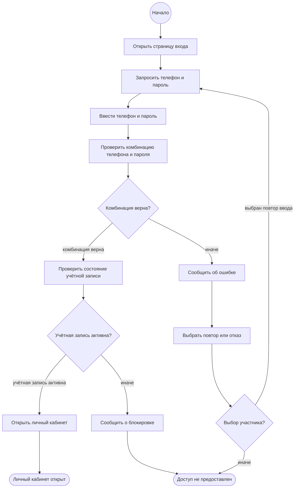

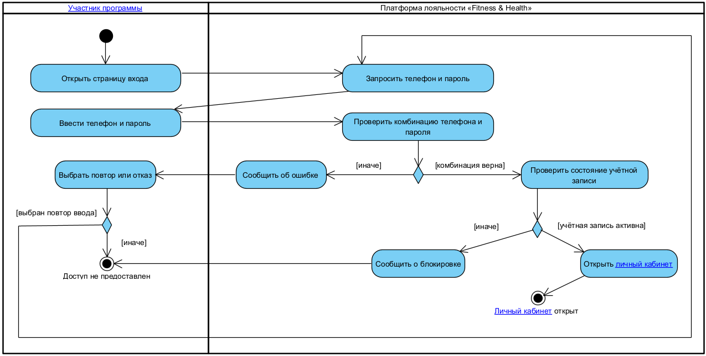

### 5.2. UC08 «Пополнить баланс карты»

**Разделы:** `Участник программы` (AC02) · `Платформа лояльности` (System) · `Платёжный шлюз` (AC04).

| Раздел | Узлы действия |
|---|---|
| Участник программы | Запросить список клубных карт · Выбрать клубную карту · Выбрать опцию «Пополнить баланс» · Ввести данные банковской карты и сумму |
| Платформа лояльности | Отобразить список клубных карт · Проверить состояние клубной карты · Отобразить детали клубной карты · Сообщить о блокировке карты · Запросить данные банковской карты и сумму · Проверить сумму пополнения · Передать запрос на списание средств · Создать операцию и обновить баланс · Начислить 50 фитнес-баллов · Сообщить о результате операции · Сообщить об ошибке оплаты · Сообщить о недоступности сервиса оплаты |
| Платёжный шлюз | Подтвердить списание средств · Отказать в проведении транзакции |

| Узел ветвления | Сторожевые условия |
|---|---|
| После «Проверить состояние клубной карты» | `[карта не заблокирована]` → Отобразить детали клубной карты · `[иначе]` → Сообщить о блокировке карты |
| После «Проверить сумму пополнения» | `[сумма корректна]` → Передать запрос на списание средств · `[иначе]` → Запросить данные банковской карты и сумму |
| После «Передать запрос на списание средств» (узел ветвления в дорожке платёжного шлюза) | `[списание подтверждено]` → Подтвердить списание средств · `[в транзакции отказано]` → Отказать в проведении транзакции · `[ответ не получен]` → узел проверки числа попыток |
| Узел проверки числа попыток (обработка тайм-аута) | `[попытки не исчерпаны]` → Передать запрос на списание средств · `[иначе]` → Сообщить о недоступности сервиса оплаты |
| После «Создать операцию и обновить баланс» | `[сумма больше 5000 рублей]` → Начислить 50 фитнес-баллов · `[иначе]` → Сообщить о результате операции |

**Узлы завершения:** `Баланс пополнен` (успех) · `Пополнение не выполнено` (неуспех).

Эталонная схема для сборки в Visual Paradigm

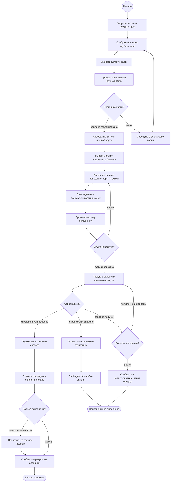

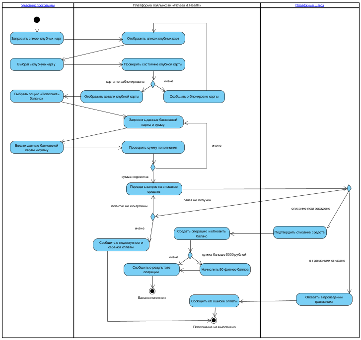

### 5.3. UC15 «Отменить бронирование»

**Разделы:** `Участник программы` (AC02) · `Платформа лояльности` (System).

| Раздел | Узлы действия |
|---|---|
| Участник программы | Запросить список бронирований · Запросить отмену бронирования · Подтвердить отмену со штрафом · Подтвердить отмену |
| Платформа лояльности | Отобразить список активных бронирований · Определить время до начала тренировки · Рассчитать штраф · Предупредить о штрафе · Запросить подтверждение отмены · Проверить баланс клубной карты · Удержать штраф с клубной карты · Заблокировать запись на сутки · Установить статус «Отменено» и освободить место · Сообщить об отмене бронирования · Сообщить о невозможности отмены |

| Узел ветвления | Сторожевые условия |
|---|---|
| После «Определить время до начала тренировки» | `[тренировка началась]` → Сообщить о невозможности отмены · `[осталось менее 2 часов]` → Рассчитать штраф · `[иначе]` → Запросить подтверждение отмены |
| После «Подтвердить отмену со штрафом» | `[отмена подтверждена]` → Проверить баланс клубной карты · `[иначе]` → Бронирование сохранено |
| После «Подтвердить отмену» | `[отмена подтверждена]` → Установить статус «Отменено» и освободить место · `[иначе]` → Бронирование сохранено |
| После «Проверить баланс клубной карты» | `[средств достаточно]` → Удержать штраф с клубной карты · `[иначе]` → Заблокировать запись на сутки |

Двум ветвям соответствуют два разных узла подтверждения: по альтернативному потоку `4А` участник подтверждает отмену уже зная размер штрафа, и это другое решение, чем подтверждение отмены без последствий.

**Узлы завершения:** `Бронирование отменено` (успех) · `Бронирование сохранено` (неуспех).

Эталонная схема для сборки в Visual Paradigm

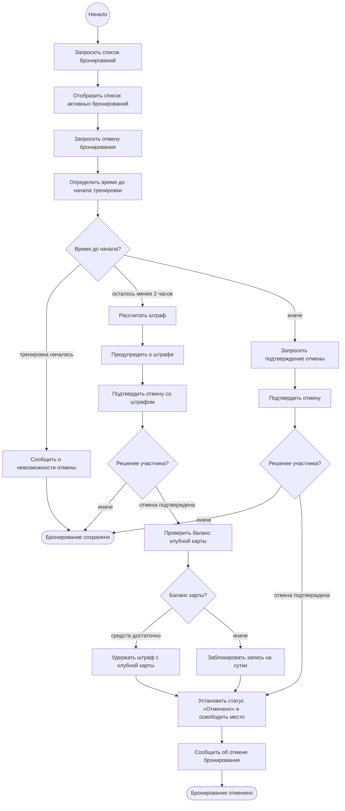

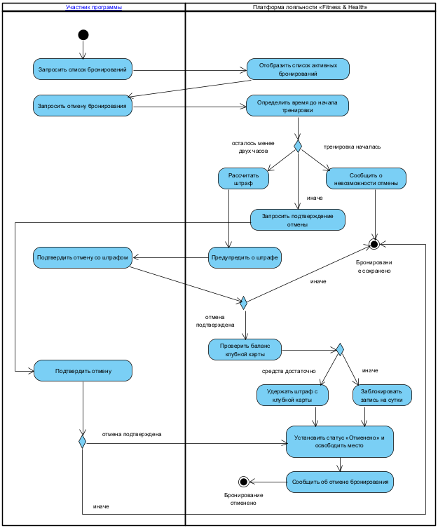

### 5.4. UC32 «Передать данные о шагах»

**Разделы:** `Фитнес-трекер` (AC06) · `Платформа лояльности` (System).

Входной узел располагается в разделе `Фитнес-трекер`: именно эта внешняя система инициирует сценарий.

| Раздел | Узлы действия |
|---|---|
| Фитнес-трекер | Передать уведомление о новых данных · Вернуть количество шагов · Отклонить запрос |
| Платформа лояльности | Проверить токен доступа · Выполнить повторную авторизацию · Пометить подключение требующим переподключения · Уведомить участника о необходимости переподключения · Пометить подключение неактивным · Предложить заново подключить фитнес-трекер · Запросить количество шагов · Сопоставить данные с участником · Проверить обработку данных за сутки · Зафиксировать повторную передачу в журнале · Рассчитать количество баллов · Начислить баллы · Проверить условие челленджа · Начислить вознаграждение «Бонусная тренировка» · Зафиксировать результат в журнале · Зафиксировать ошибку в журнале |

| Узел ветвления | Сторожевые условия |
|---|---|
| После «Проверить токен доступа» | `[токен действителен]` → Запросить количество шагов · `[токен недействителен]` → Выполнить повторную авторизацию · `[доступ отозван участником]` → Пометить подключение неактивным |
| После «Выполнить повторную авторизацию» | `[авторизация успешна]` → Запросить количество шагов · `[иначе]` → Пометить подключение требующим переподключения |
| После «Запросить количество шагов» (узел ветвления в дорожке фитнес-трекера) | `[данные получены]` → Вернуть количество шагов · `[ответ не распознан]` → Отклонить запрос · `[ответ не получен]` → узел проверки числа попыток |
| Узел проверки числа попыток (обработка тайм-аута) | `[попытки не исчерпаны]` → Запросить количество шагов · `[иначе]` → Зафиксировать ошибку в журнале |
| После «Проверить обработку данных за сутки» | `[данные не обработаны]` → Рассчитать количество баллов · `[иначе]` → Зафиксировать повторную передачу в журнале |
| После «Проверить условие челленджа» | `[условие выполнено]` → Начислить вознаграждение «Бонусная тренировка» · `[иначе]` → Зафиксировать результат в журнале |

**Узлы завершения:** `Баллы начислены` (успех) · `Данные не обработаны` (неуспех). Повторная передача данных за уже обработанные сутки ведёт в узел `Данные не обработаны`: баллы по ней не начисляются, в журнале фиксируется только сам факт дубликата.

Эталонная схема для сборки в Visual Paradigm

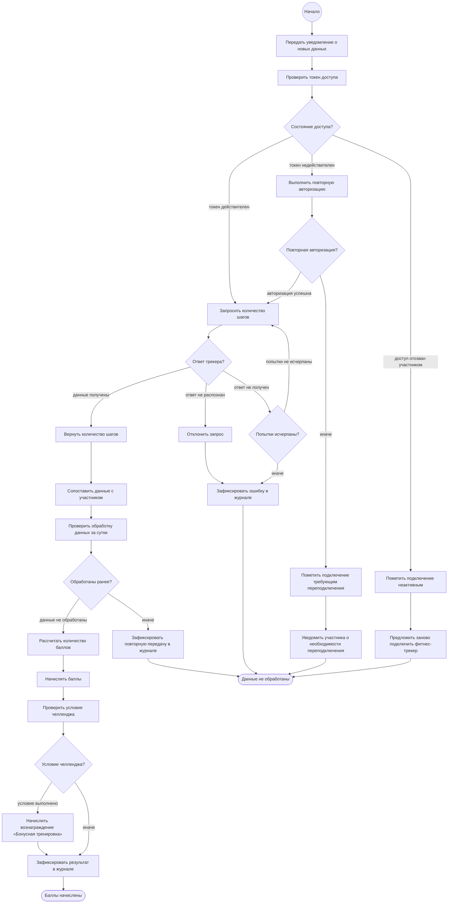

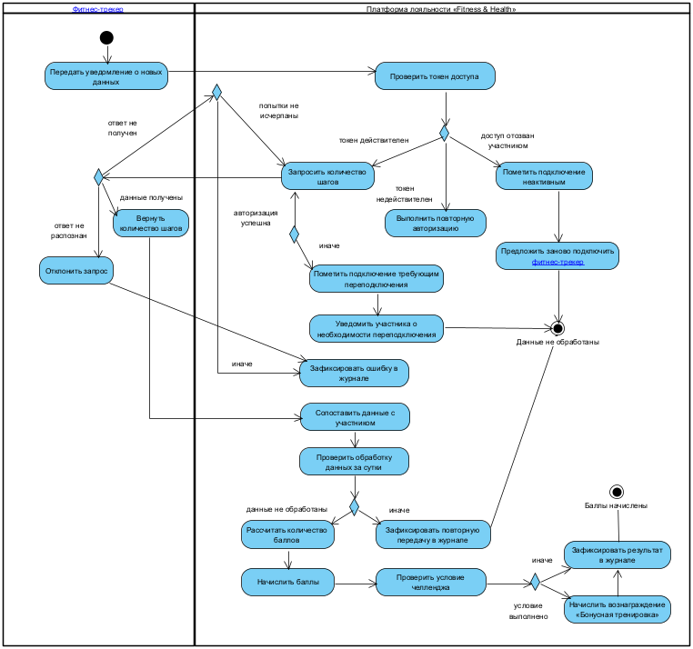

---

## 6. Реализация в Visual Paradigm

### 6.1. Спецификация в редакторе Use Case Details

Описание внесено в модель, чтобы спецификация опиралась на уже наработанные элементы - акторов, глоссарий, диаграмму классов - и могла быть конвертирована в диаграммы.

Порядок работы для каждого варианта использования:

1. Выделить вариант использования на диаграмме или в `Model Explorer`, вызвать контекстное меню → `Open Use Case Details…`.
2. Вкладка **Info**: проверить `ID`, задать `Rank` (High для всех четырёх), выбрать `Primary Actors`, вставить краткое описание в поле `Description`.
3. Вкладка **Details**: заполнить `Pre-conditions` и `Post-conditions`.
4. Вкладка **Flow of Events**: кнопкой `Edit Scenario` переименовать сценарий по умолчанию в «Основной поток событий». Шаги действующего лица добавляются командой `Add Actor` (с выбором актора), шаги системы - командой `Add Control → System Response`.
5. Альтернативные потоки: выделить шаг основного потока, на котором происходит переключение, контекстное меню → `Add Extension`, задать имя расширения и его шаги.

> В редакторе `Flow of Events` подлежащее шага подставляется автоматически из выбранного действующего лица или из `SYSTEM`, поэтому в поле шага вводится только сказуемое с дополнением: выбрав актора «Участник программы» и введя «вводит номер телефона и пароль», получаем шаг «3. Участник программы вводит номер телефона и пароль». Это и есть требование чек-листа 3.13 «кто владеет мячом», реализованное средствами инструмента.

**Результат внесения спецификации в модель.**

Вкладка `Info` - идентификатор, ранг, основное действующее лицо и краткое описание:

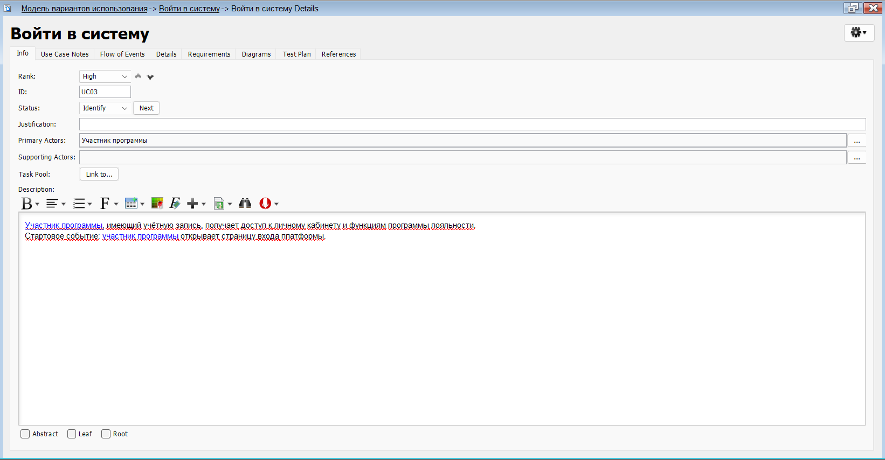

Вкладка `Details` - предусловия и постусловия:

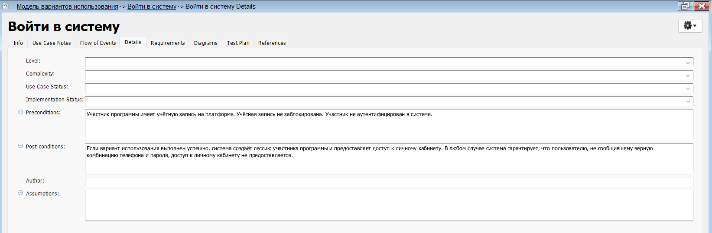

Вкладка `Flow of Events` - основной поток и расширения:

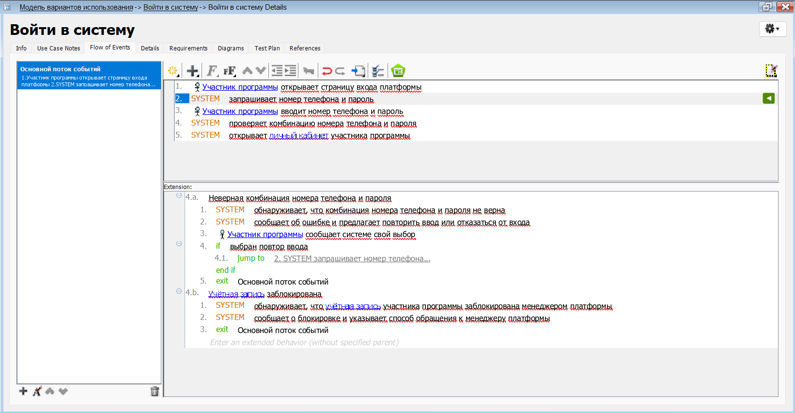
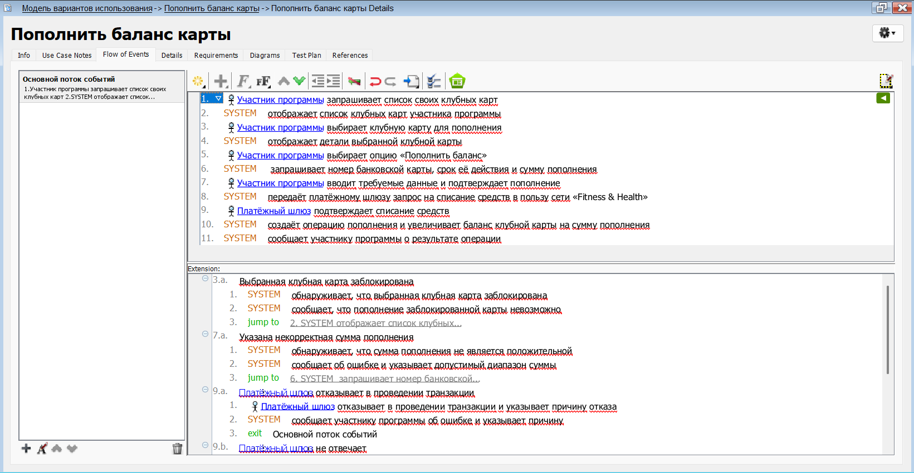
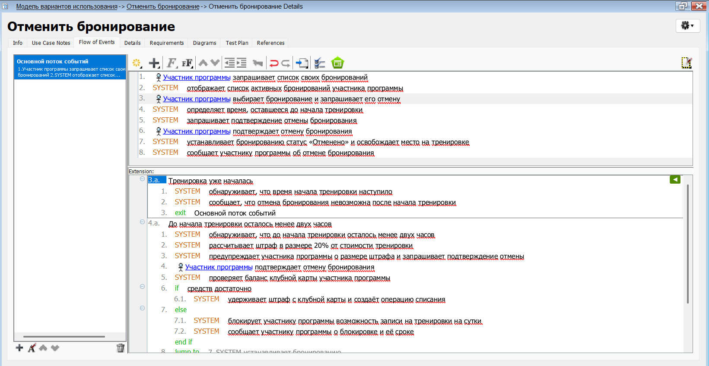
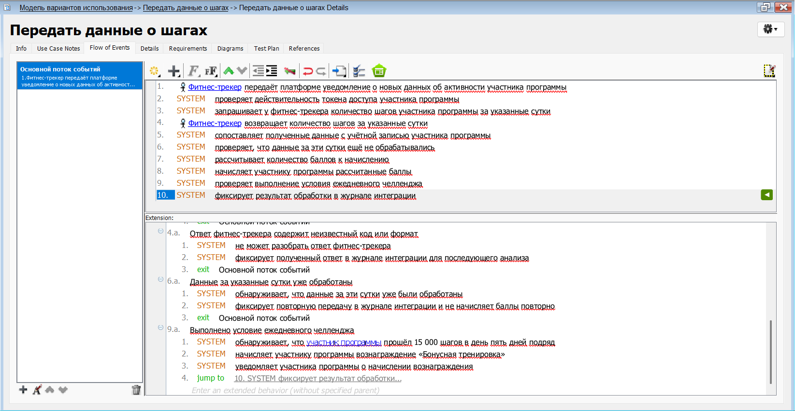

### 6.2. Построение диаграмм деятельности

1. На диаграмме вариантов использования выделить вариант использования → контекстное меню → `Sub Diagrams / New Diagram` → `Activity Diagram`.
2. Добавить разделы `Vertical Swimlane` по числу действующих лиц плюс один для системы. Для каждого раздела открыть спецификацию, вкладка `General`, поле `Represents`: действующих лиц выбрать из пакета `Actor`, систему - из пакета `System`.
3. Поместить `Initial Node` в раздел основного действующего лица.
4. Разместить узлы `Action` по разделам согласно таблицам раздела 5, добавить `Decision Node`, соединить `Control Flow`.
5. Сторожевые условия задать через спецификацию потока, вкладка `General`, поле `Guard` (или контекстное меню потока → `Guard…`).
6. Добавить два `Activity Final Node` с именами успешного и неуспешного завершения.

Альтернативный путь - автогенерация: вкладка `Flow of Events` → `Synchronize to diagram` → `Synchronize to Activity Diagram`. Результат требует ручной доводки, но позволяет быстро проверить логику потоков.

### 6.3. Исправления модели, выполненные перед началом работы

При подготовке ЛР4 в проекте Visual Paradigm обнаружены и устранены три расхождения модели с документацией:

| Что | Проявление | Исправление |
|---|---|---|
| UC15 | Вариант использования остался с именем по умолчанию `UseCase` | Переименован в «Отменить бронирование» |
| UC31 | Вариант использования остался с именем по умолчанию `UseCase2` | Переименован в «Передать сведения об использованном вознаграждении» |
| Класс `Class` | В модели классов остался пустой класс с именем по умолчанию, без атрибутов и связей | Удалён (нарушал критерии 2.2, 2.5, 2.8 чек-листа) |

---

## 7. Соответствие чек-листу

| Критерий | Где в работе | Статус |
|---|---|---|
| 1.1 Цели и задачи работы | §1.1 | ✅ |
| 1.4 Чёткая структура документации | §1–§7 | ✅ |
| 3.9 Определены предусловия | §4.1–4.4 | ✅ |
| 3.10 Определено стартовое событие | §4.1–4.4 | ✅ |
| 3.11 Шаги основного и альтернативных потоков | §4.1–4.4 | ✅ |
| 3.12 Определён ожидаемый результат | §4.1–4.4, постусловия | ✅ |
| 3.13 Каждый шаг начинается с подлежащего | §4.1–4.4 | ✅ |
| 3.14 Каждый шаг - простое предложение | §4.1–4.4 | ✅ |
| 3.15 Шаблон «подлежащее - сказуемое - дополнение» | §4.1–4.4 | ✅ |
| 3.16 Вариант использования - диалог | §4.1–4.4 | ✅ |
| 3.17 Показано намерение, а не движение | §4.1–4.4 | ✅ |
| 3.18 Каждый шаг продвигает процесс | §4.1–4.4 | ✅ |
| 3.19 Диаграмма деятельности соответствует описанию | §5.1–5.4 | ✅ |
| 3.20 Вариант использования связан с User Story | §4.1–4.4 | ✅ |
| 3.21 Минимизированы цепочки с зависимостями | §2.3 (UC29 и UC30 раскрыты внутри UC08) | ✅ |
| 3.22 Атомарность сценариев | §4.1–4.4 | ✅ |
| 4.x Диаграмма последовательностей | - | ⏳ ЛР №5 |
| 5.x Функциональные и нефункциональные требования | §3 - каталог бизнес-правил как их часть | 🟡 частично |
| 6.1 Прототипы экранных форм | - | ⏳ ЛР №5 (раскадровка) |
| 7.1 Сценарии тестирования | §4.1–4.4 - критерии приёмки как их основа | 🟡 частично |
