# Лабораторная работа №5. Разработка модели взаимодействия

| | |
|---|---|
| **Кейс** | Система управления программой лояльности сети фитнес-клубов «Fitness & Health» |
| **Учебник** | Галиаскаров Э.Г., Воробьёв А.С. «Анализ и проектирование систем с использованием UML», гл. 5 |
| **Инструменты** | Visual Paradigm 18.1 (диаграммы последовательности) + HTML/CSS/JS (кликабельный прототип экранных форм) |
| **Автор** | Белянкин Артемий Русланович, БИ 3-3 |

> ЛР5 отвечает на два следующих: **«как это выглядит для пользователя»** (раскадровка) и **«какие операции система обязана предоставить»** (системные события → системные операции). Это переход от аналитической модели к модели реализации.

---

## 1. Общие сведения

### 1.1. Цель и задачи работы

**Цель работы:** построить модель взаимодействия пользователя с системой - от внешнего вида экранных форм до перечня операций, которые система должна реализовать.

**Задачи работы:**
1. Составить раскадровку выбранных вариантов использования - последовательность макетов экранных форм.
2. Описать все экранные формы проекта и их интерфейсные элементы.
3. Построить системные диаграммы последовательности для четырёх вариантов использования.
4. Выявить системные события и преобразовать каждое в системную операцию.
5. Составить спецификацию каждой системной операции по единому шаблону.
6. Сформировать сценарии тестирования на основе критериев приёмки из ЛР4.

### 1.2. Три артефакта и связь между ними

| Артефакт | Что показывает | Из чего вырастает |
|---|---|---|
| **Раскадровка** | Внешнюю сторону диалога: что видит участник на каждом шаге | Из шагов основного и альтернативных потоков ЛР4 |
| **Системная диаграмма последовательности** | Обмен сообщениями между действующими лицами и системой во времени. Система - «чёрный ящик» | Из того же описания потоков; порядок сообщений обязан совпадать |
| **Спецификация системных операций** | Контракт каждой операции: параметры, возврат, пред- и постусловия | Из стрелок, входящих в lifeline системы |

Связь жёсткая: **один шаг потока событий = один экран раскадровки = одно сообщение на диаграмме последовательности**. Если артефакты расходятся - ошибка в одном из них, а не «разные взгляды».

Декомпозиция системы на boundary-, control- и entity-классы в этой работе **не выполняется**: здесь система остаётся единым объектом. Это предмет ЛР6.

---

## 2. Раскадровка вариантов использования

### 2.1. Принципы построения

Из чек-листа главы 5:

- раскадровка начинается с экрана, соответствующего **предусловию** варианта использования;
- каждый экран соответствует **одному шагу** описания варианта использования;
- в раскадровке используются **конкретные данные**, а не заглушки: видно, как действие участника меняет состояние формы;
- последовательность экранов должна быть согласована с описанием ВИ и диаграммой деятельности.

**Чем сделано.** Вместо набора статичных картинок собран **кликабельный прототип**: [`wireframes/prototype.html`](wireframes/prototype.html). Он открывается в браузере без установки чего-либо и проходится как настоящий сайт - по обоим сценариям, включая альтернативные потоки. Экраны раскадровки ниже - снимки состояний этого же прототипа, поэтому макеты и прототип не могут разойтись: это один и тот же код.

Под рабочей областью прототип показывает, какому шагу варианта использования соответствует текущий экран, - та же привязка, что в подписях ниже. Альтернативные потоки помечены отдельным цветом.

Прототип воспроизводит бизнес-правила кейса, а не просто рисует формы:

| Что ввести | Что произойдёт | Поток / правило |
|---|---|---|
| Пароль `123456` | Успешный вход в личный кабинет | UC03, основной поток |
| Любой другой пароль | Сообщение об ошибке с выбором действия | UC03, поток `4А` |
| Телефон `+7 999 000-00-00` | Сообщение о блокировке учётной записи | UC03, поток `4Б` |
| Сумма до 100 ₽ или свыше 50 000 ₽ | Ошибка валидации с указанием диапазона | UC08, поток `7А` |
| Сумма свыше 5 000 ₽ | Начисление 50 фитнес-баллов | UC08, поток `10А`, `BR-007` |
| Банковская карта, оканчивающаяся на `0000` | Отказ платёжного шлюза, баланс не меняется | UC08, поток `9А` |
| Выбор заблокированной карты | Пополнение недоступно | UC08, поток `3А`, `BR-008` |

Благодаря этому прототип работает как исполняемая проверка сценариев тестирования из §5: TC-01, TC-02, TC-03, TC-04, TC-05, TC-07 и TC-08 проходятся прямо в браузере, без доступа к коду системы.

Учебник предлагает встроенный редактор Wireframe в Visual Paradigm или внешний инструмент прототипирования (Figma, Axure, Balsamiq) и прямо оговаривает, что ограничений по инструменту нет. HTML выбран потому, что даёт интерактивность, версионируется в репозитории вместе с остальной работой и правится текстом, а не мышью.

Раскадровка сделана для двух вариантов использования с наибольшим приоритетом - UC03 и UC08. Экранные формы остальных ВИ описаны таблицей в §2.4: пункт 6.1 чек-листа практикума прямо допускает «наличие макетов **или табличного описания** всех экранных форм».

### 2.2. UC03 «Войти в систему»

**Экран 1. Стартовая страница платформы** - соответствует предусловию: участник не аутентифицирован. Стартовое событие ВИ происходит по нажатию «Войти».

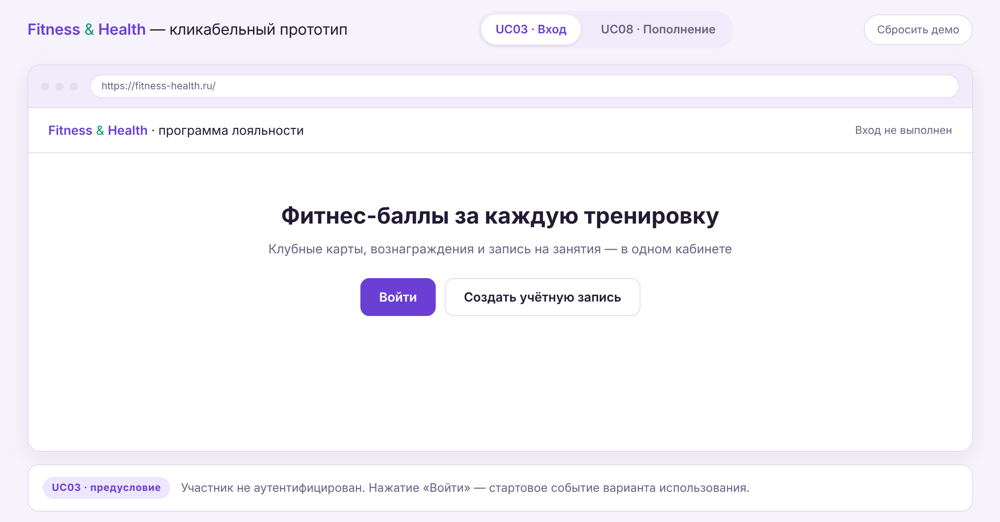

**Экран 2. Форма входа** - шаг 2 основного потока: система запрашивает номер телефона и пароль.

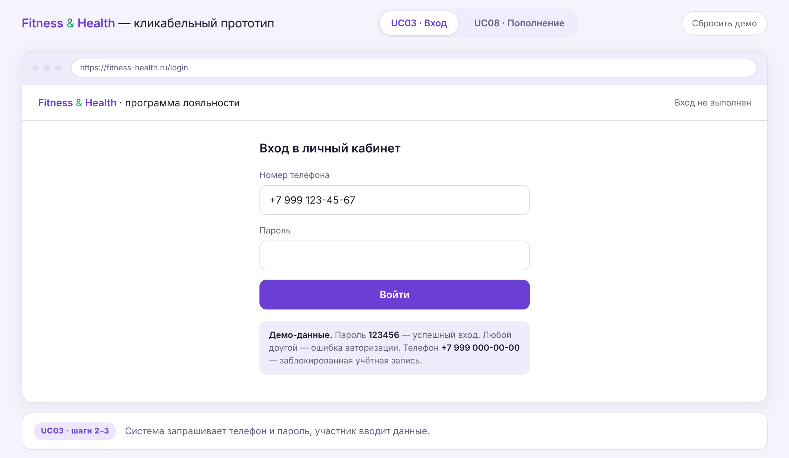

**Экран 3. Форма входа с введёнными данными** - шаг 3: участник ввёл телефон и пароль. Пароль маскируется.

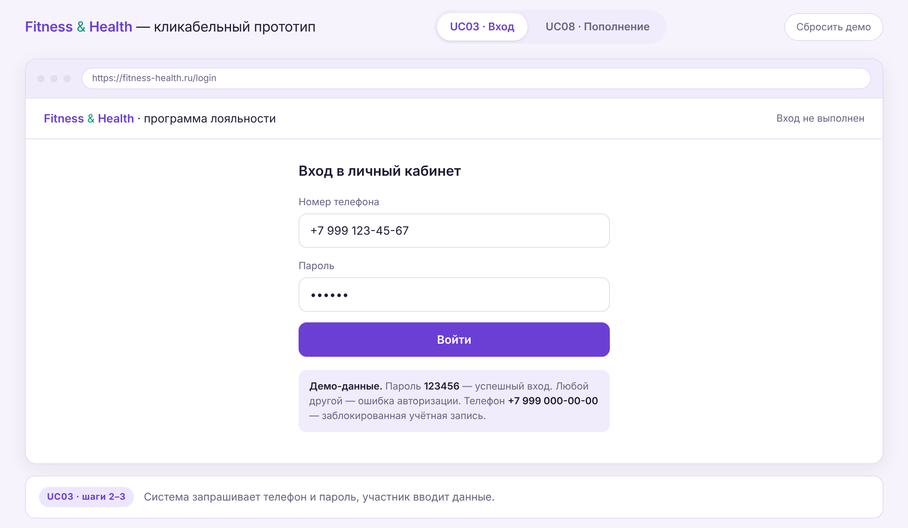

**Экран 4. Неверная комбинация телефона и пароля** - альтернативный поток `4А`, шаги 2–3: система сообщает об ошибке и предлагает выбор. Сообщение намеренно не уточняет, какое из двух полей заполнено неверно, - этого требует критерий приёмки 2 из ЛР4.

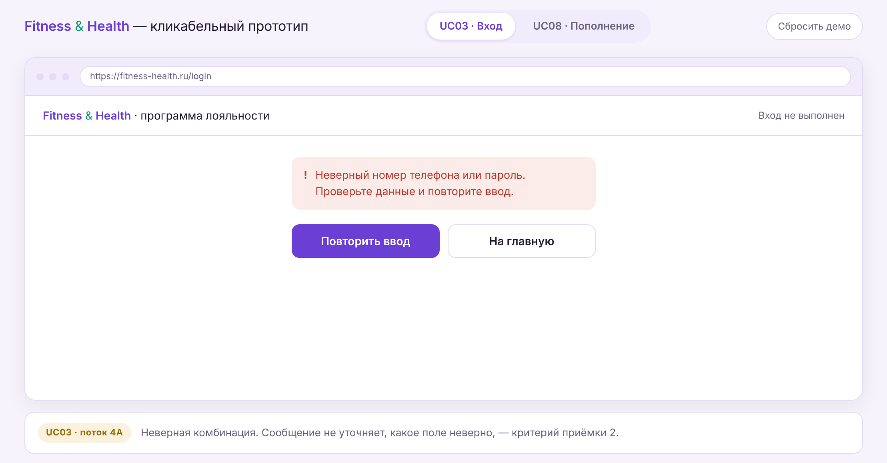

**Экран 5. Учётная запись заблокирована** - альтернативный поток `4Б`: система сообщает о блокировке и указывает способ обращения к менеджеру платформы.

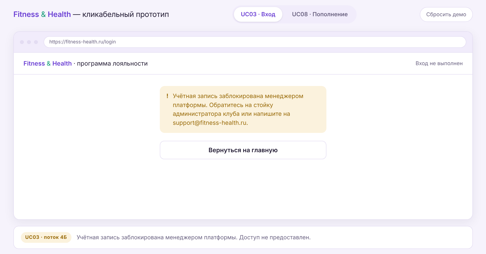

**Экран 6. Личный кабинет участника** - шаг 5, успешное завершение. Постусловие ВИ выполнено: сессия создана, доступ к функциям программы предоставлен.

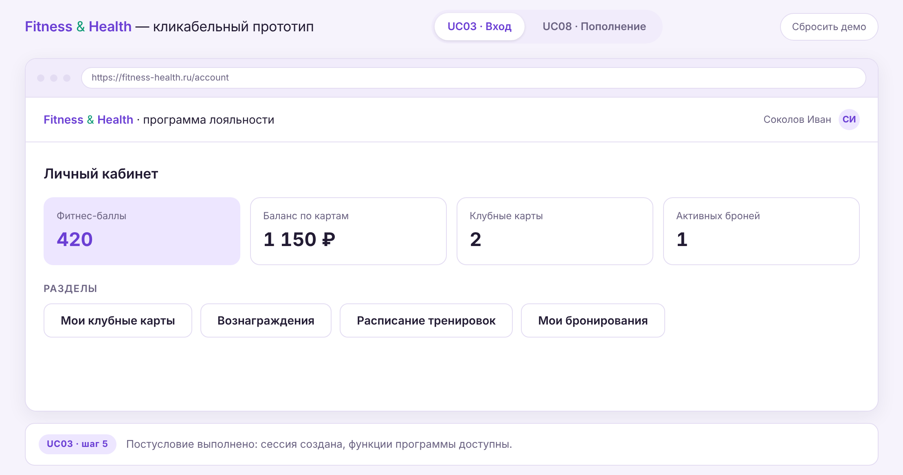

### 2.3. UC08 «Пополнить баланс карты»

**Экран 1. Список клубных карт** - шаг 2 основного потока. В списке намеренно показаны карты в обоих состояниях: активная и заблокированная. Это иллюстрирует бизнес-правило `BR-008` и альтернативный поток `3А`.

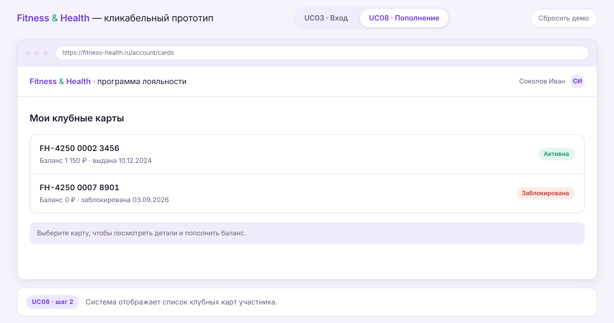

**Экран 2. Детали выбранной клубной карты** - шаг 4: номер, статус, баланс, последние операции и действие «Пополнить баланс».

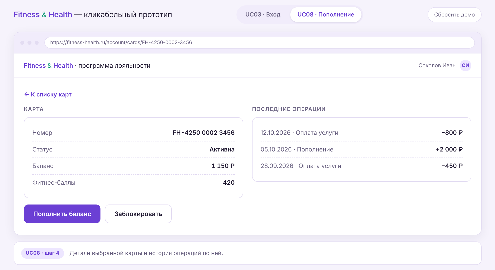

**Экран 3. Форма пополнения** - шаг 6: система запрашивает номер банковской карты, срок её действия и сумму пополнения. Подпись поля суммы задаёт допустимый диапазон - это та информация, которую система выдаёт в альтернативном потоке `7А`.

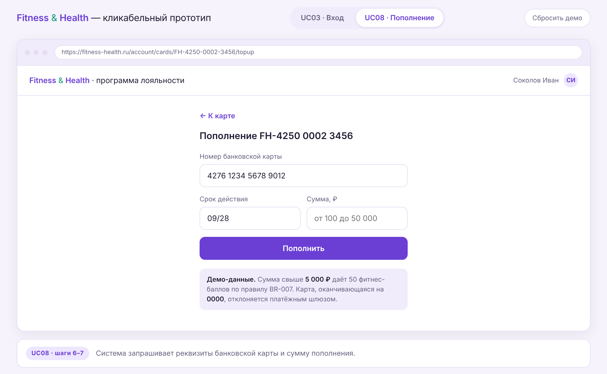

**Экран 4. Форма пополнения с введёнными данными** - шаг 7. Сумма 6 000 ₽ выбрана намеренно: она превышает порог 5 000 ₽ и активирует правило `BR-007`.


**Экран 5. Успешное пополнение** - шаги 10–11 и альтернативный поток `10А`: баланс вырос с 1 150 ₽ до 7 150 ₽, баллы с 420 до 470, создана операция пополнения.

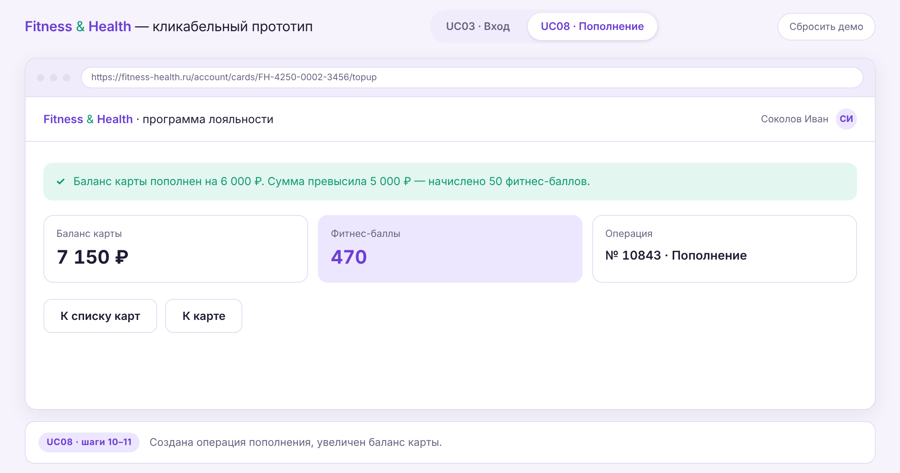

**Экран 6. Платёжный шлюз отказал в транзакции** - альтернативный поток `9А`. Экран подтверждает постусловие неуспеха: баланс карты и количество баллов не изменились, деньги с банковской карты не списаны.

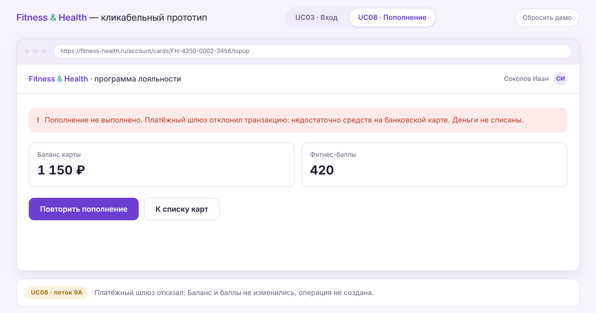

### 2.4. Табличное описание экранных форм

Таблица покрывает экранные формы всех четырёх вариантов использования и описывает интерфейсные элементы каждой - это закрывает пункты 5.1 и 6.1 чек-листа практикума.

#### UC03 «Войти в систему»

| Экран | Шаг ВИ | Элементы интерфейса | Действия и реакция системы |
|---|---|---|---|
| Стартовая страница | предусловие | Заголовок платформы, кнопка «Войти», кнопка «Создать учётную запись» | «Войти» → переход к форме входа |
| Форма входа | 2 | Поле «Номер телефона» (маска `+7 ___ ___-__-__`), поле «Пароль» (маскированный ввод), кнопка «Войти» | «Войти» → проверка комбинации |
| Сообщение об ошибке | 4А | Блок ошибки, кнопка «Повторить ввод», кнопка «Вернуться на главную» | «Повторить ввод» → форма входа; «Вернуться на главную» → стартовая страница |
| Сообщение о блокировке | 4Б | Блок предупреждения с контактами поддержки, кнопка «Вернуться на главную» | Доступ не предоставляется |
| Личный кабинет | 5 | Плитки «Фитнес-баллы», «Клубные карты», «Баланс по картам», «Активных броней»; кнопки разделов | Переход в выбранный раздел |

#### UC08 «Пополнить баланс карты»

| Экран | Шаг ВИ | Элементы интерфейса | Действия и реакция системы |
|---|---|---|---|
| Список клубных карт | 2 | Строки карт: номер, баланс, дата выдачи, статус-метка «Активна»/«Заблокирована» | Выбор карты → детали карты |
| Детали карты | 4 | Панель «Карта» (номер, статус, баланс, баллы), панель «Последние операции», кнопки «Пополнить баланс», «Заблокировать» | «Пополнить баланс» → форма пополнения |
| Сообщение о блокировке карты | 3А | Блок ошибки | Возврат к списку карт |
| Форма пополнения | 6 | Поля «Номер банковской карты», «Срок действия», «Сумма пополнения» с указанием диапазона, кнопка «Пополнить» | «Пополнить» → проверка суммы и запрос платёжному шлюзу |
| Успешное пополнение | 11, 10А | Блок успеха, плитки «Баланс карты», «Фитнес-баллы», «Операция», кнопки навигации | Переход к списку карт или истории операций |
| Ошибка оплаты | 9А, 9Б | Блок ошибки с причиной отказа либо сообщением о недоступности сервиса, плитки с неизменными значениями, кнопка «Повторить пополнение» | Повтор или возврат к списку карт |

#### UC15 «Отменить бронирование»

| Экран | Шаг ВИ | Элементы интерфейса | Действия и реакция системы |
|---|---|---|---|
| Список активных бронирований | 2 | Строки бронирований: тренировка, клуб, дата и время, тренер, стоимость, статус | Выбор брони → запрос отмены |
| Подтверждение отмены | 5 | Карточка бронирования, кнопки «Отменить бронирование» и «Оставить» | Подтверждение → отмена без последствий |
| Предупреждение о штрафе | 4А.3 | Блок предупреждения с рассчитанной суммой штрафа (20% от стоимости) и остатком времени до начала, кнопки подтверждения и отказа | Подтверждение → проверка баланса карты |
| Сообщение об отмене | 8 | Блок успеха: новый статус брони, сумма удержанного штрафа (если был) | Возврат к списку бронирований |
| Сообщение о блокировке записи | 4А.5А | Блок предупреждения: запись заблокирована на сутки, указано время снятия блокировки | Возврат к списку бронирований |
| Сообщение о невозможности отмены | 3А | Блок ошибки: тренировка уже началась | Возврат к списку бронирований |

#### UC32 «Передать данные о шагах»

Собственных экранных форм у этого варианта использования **нет**: сценарий инициирует внешняя система, участник в диалоге не задействован. Пользователь видит только асинхронные уведомления, которые система формирует по результатам обработки.

| Уведомление | Поток ВИ | Содержание |
|---|---|---|
| Начислены баллы за активность | основной, шаг 8 | Количество начисленных баллов за сутки и новое значение счётчика |
| Начислено вознаграждение «Бонусная тренировка» | 9А | Название вознаграждения и условие, за которое оно начислено |
| Требуется переподключить фитнес-трекер | 2А, 2Б | Причина (истёк токен или отозван доступ) и ссылка на повторное подключение |

---

## 3. Системные диаграммы последовательности

### 3.1. Системные события и системные операции

**Системное событие** - внешнее по отношению к системе событие, на которое система должна отреагировать. На диаграмме это стрелка, идущая от действующего лица и **входящая в lifeline системы**.

**Системная операция** - это же событие, преобразованное в программную операцию с именем, параметрами и возвращаемым значением.

На системной диаграмме последовательности присутствуют **только действующие лица и система**. Система изображается «чёрным ящиком»: что происходит у неё внутри, здесь не показывается. Фактически мы выявляем функциональность системы в контексте варианта использования.

Два типа стрелок:
- **Message** (сплошная) - от действующего лица к системе; это и есть системное событие;
- **Reply** (пунктирная) - ответ системы действующему лицу: появление формы, списка, сообщения. В операции **не преобразуется**, но помогает корректно сформулировать постусловие предыдущей операции.

> **Решение по UC32.** Уведомления участнику программы (о начислении баллов, о вознаграждении, о необходимости переподключить трекер) на диаграмму не выносятся: участник не является действующим лицом этого варианта использования, а уведомления не порождают системных событий. Они зафиксированы как постусловия соответствующих операций в §4.5.

### 3.2. Подготовка модели в Visual Paradigm

Перед построением диаграмм в проекте выполнены две настройки и создана структура пакетов, которой требует чек-лист главы:

1. Отключён вывод активаций: `Project Options → Diagramming → Interaction → Show activations in Sequence Diagram`.
2. Отключена нумерация сообщений.
3. В `Model Explorer` создана иерархия пакетов: **Модель структуры → Модель приложения → Программные классы**, в последнем - класс **«Система»**.

Класс «Система» перетаскивается на диаграмму как lifeline, действующие лица - из пакета `Действующие лица`. По мере преобразования сообщений в операции класс «Система» накапливает их список - в ЛР6 эти операции будут распределены между boundary-, control- и entity-классами.

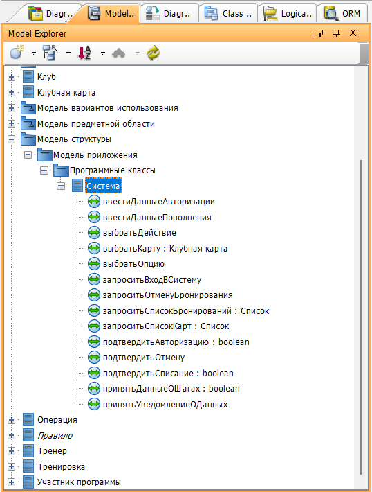

### 3.3. UC03 «Войти в систему»

**Lifelines:** `Участник программы` (AC02) · `Система`.

| № | От | К | Сообщение | Тип | Системная операция |
|---:|---|---|---|---|---|
| 1 | Участник программы | Система | Войти на страницу входа платформы | Message | `запроситьВходВСистему()` |
| | | | **loop** `[пока телефон и пароль не верны и не выбран отказ от входа]` | | |
| 2 | Система | Участник программы | Запрос телефона и пароля | Reply | - |
| 3 | Участник программы | Система | Ввести телефон и пароль | Message | `ввестиДанныеАвторизации(телефон, пароль)` |
| | | | **alt** `[комбинация верна и учётная запись активна]` | | |
| 4 | Система | Участник программы | Отображает личный кабинет участника | Reply | - |
| | | | `[учётная запись заблокирована]` | | |
| 5 | Система | Участник программы | Сообщает о блокировке учётной записи | Reply | - |
| | | | `[иначе]` | | |
| 6 | Система | Участник программы | Сообщает об ошибке и предлагает сделать выбор | Reply | - |
| 7 | Участник программы | Система | Выбрать действие | Message | `выбратьДействие(действие)` |
| | | | **opt** `[выбран отказ от входа]` | | |
| 8 | Система | Участник программы | Возвращает на стартовую страницу | Reply | - |

Фрагмент `alt` имеет **три операнда**, а не два: учётная запись может быть заблокирована - это альтернативный поток `4Б` из ЛР4. Операнды добавляются командой `Operand → Add operand` в спецификации фрагмента.

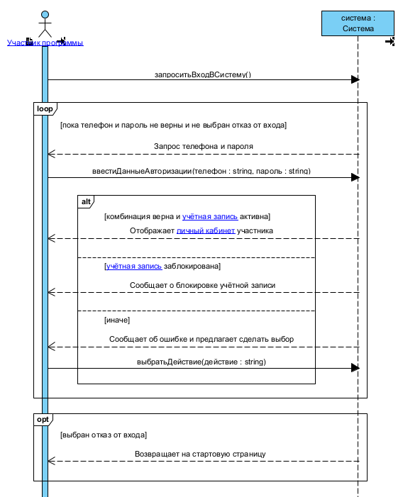

### 3.4. UC08 «Пополнить баланс карты»

**Lifelines:** `Участник программы` (AC02) · `Система` · `Платёжный шлюз` (AC04).

| № | От | К | Сообщение | Тип | Системная операция |
|---:|---|---|---|---|---|
| 1 | Участник программы | Система | Запросить список клубных карт | Message | `запроситьСписокКарт(idУчастника)` |
| 2 | Система | Участник программы | Список клубных карт | Reply | - |
| 3 | Участник программы | Система | Выбрать клубную карту | Message | `выбратьКарту(idКарты)` |
| | | | **alt** `[карта не заблокирована]` | | |
| 4 | Система | Участник программы | Детали выбранной карты | Reply | - |
| | | | `[иначе]` | | |
| 5 | Система | Участник программы | Сообщает, что пополнение заблокированной карты невозможно | Reply | - |
| 6 | Участник программы | Система | Выбрать опцию «Пополнить баланс» | Message | `выбратьОпцию(опция)` |
| 7 | Система | Участник программы | Форма ввода данных банковской карты и суммы | Reply | - |
| | | | **loop** `[пока сумма пополнения некорректна]` | | |
| 8 | Участник программы | Система | Ввести данные банковской карты и сумму | Message | `ввестиДанныеПополнения(номерБК, срокДействия, сумма)` |
| 9 | Система | Платёжный шлюз | Запрос на списание средств | Message | - |
| 10 | Платёжный шлюз | Система | Подтвердить списание средств | Message | `подтвердитьСписание(сумма): boolean` |
| | | | **alt** `[списание подтверждено]` | | |
| 11 | Система | Участник программы | Баланс карты обновлён, номер операции | Reply | - |
| | | | **opt** `[сумма больше 5000 рублей]` | | |
| 12 | Система | Участник программы | Сообщает о начислении 50 фитнес-баллов | Reply | - |
| | | | `[в транзакции отказано]` | | |
| 13 | Система | Участник программы | Сообщает об ошибке оплаты и указывает причину | Reply | - |
| | | | `[ответ не получен]` | | |
| 14 | Система | Участник программы | Сообщает о недоступности сервиса оплаты | Reply | - |

Сообщение 10 идёт **от платёжного шлюза в систему** - это системное событие наравне с действиями участника, поэтому оно тоже становится операцией. Сообщение 9, наоборот, исходит из системы и операцией не является.

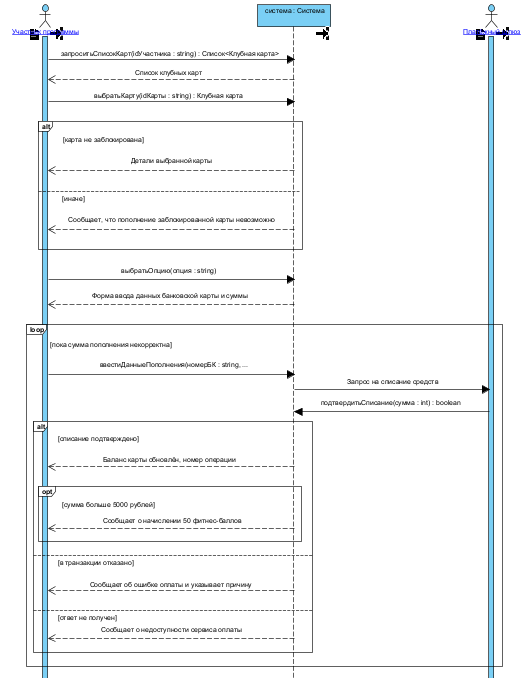

### 3.5. UC15 «Отменить бронирование»

**Lifelines:** `Участник программы` (AC02) · `Система`.

| № | От | К | Сообщение | Тип | Системная операция |
|---:|---|---|---|---|---|
| 1 | Участник программы | Система | Запросить список бронирований | Message | `запроситьСписокБронирований(idУчастника)` |
| 2 | Система | Участник программы | Список активных бронирований | Reply | - |
| 3 | Участник программы | Система | Запросить отмену бронирования | Message | `запроситьОтменуБронирования(idБронирования)` |
| | | | **alt** `[тренировка началась]` | | |
| 4 | Система | Участник программы | Сообщает о невозможности отмены | Reply | - |
| | | | `[до начала менее двух часов]` | | |
| 5 | Система | Участник программы | Предупреждает о штрафе и запрашивает подтверждение | Reply | - |
| | | | `[иначе]` | | |
| 6 | Система | Участник программы | Запрашивает подтверждение отмены | Reply | - |
| 7 | Участник программы | Система | Подтвердить отмену | Message | `подтвердитьОтмену(idБронирования, согласие)` |
| | | | **alt** `[отмена подтверждена и средств достаточно]` | | |
| 8 | Система | Участник программы | Бронирование отменено, удержан штраф | Reply | - |
| | | | `[отмена подтверждена и средств недостаточно]` | | |
| 9 | Система | Участник программы | Бронирование отменено, запись заблокирована на сутки | Reply | - |
| | | | `[иначе]` | | |
| 10 | Система | Участник программы | Бронирование сохранено в статусе «Активно» | Reply | - |

Второй фрагмент `alt` разделяет два исхода подтверждённой отмены - это те же ветви, что на диаграмме деятельности ЛР4 после узла «Проверить баланс клубной карты».

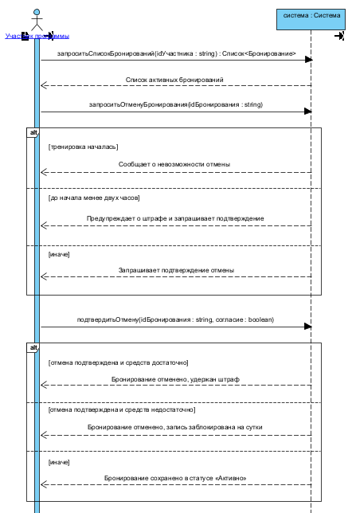

### 3.6. UC32 «Передать данные о шагах»

**Lifelines:** `Фитнес-трекер` (AC06) · `Система`.

| № | От | К | Сообщение | Тип | Системная операция |
|---:|---|---|---|---|---|
| 1 | Фитнес-трекер | Система | Передать уведомление о новых данных об активности | Message | `принятьУведомлениеОДанных(idПодключения, дата)` |
| | | | **alt** `[токен действителен]` | | |
| 2 | Система | Фитнес-трекер | Запрос количества шагов за сутки | Message | - |
| | | | `[иначе]` | | |
| 3 | Система | Фитнес-трекер | Запрос повторной авторизации | Message | - |
| 4 | Фитнес-трекер | Система | Подтвердить авторизацию | Message | `подтвердитьАвторизацию(idПодключения, токен): boolean` |
| 5 | Система | Фитнес-трекер | Запрос количества шагов за сутки | Message | - |
| | | | **loop** `[пока ответ не получен и попытки не исчерпаны]` | | |
| 6 | Система | Фитнес-трекер | Повторный запрос количества шагов | Message | - |
| 7 | Фитнес-трекер | Система | Вернуть количество шагов за сутки | Message | `принятьДанныеОШагах(idПодключения, дата, шаги): boolean` |

Единственная диаграмма, где **ни одного Reply**: система не отвечает фитнес-трекеру на экран - она обменивается с ним вызовами API. Зато здесь два входящих события от внешней системы, и оба становятся операциями. Это и есть характерное отличие интеграционного варианта использования, зафиксированное ещё в ЛР4 по материалам GetAnalyst.

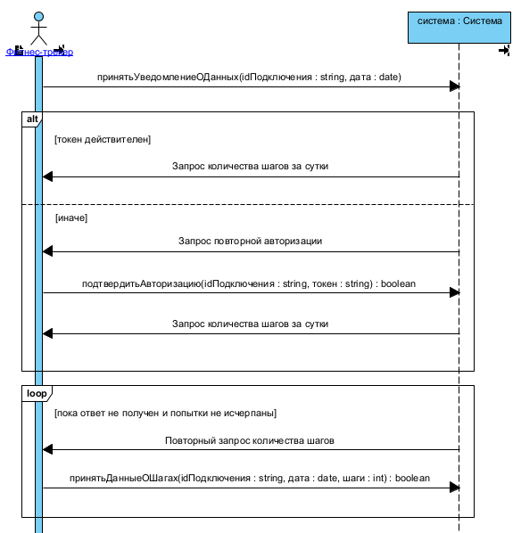

---

## 4. Спецификации системных операций

### 4.1. Шаблон

Для каждой операции указываются семь полей, как требует гл. 5: ссылка на вариант использования, название исходного события, название операции, тип возвращаемого значения, параметры и их типы, предусловия, постусловия. Постусловия формулируются в терминах модели классов ЛР3 - создание или удаление экземпляра, модификация атрибута, формирование или разрыв ассоциации.

### 4.2. UC03 «Войти в систему»

**SO-01**

| Поле | Значение |
|---|---|
| Вариант использования | UC03 «Войти в систему» |
| Название исходного события | Войти на страницу входа платформы |
| Название операции | `запроситьВходВСистему` |
| Тип возвращаемого значения | - |
| Параметры | - |
| Предусловия | Участник программы находится на стартовой странице платформы, сессия не создана |
| Постусловия | Создана форма входа (создание экземпляра граничного объекта). Объекты предметной области не изменяются |

**SO-02**

| Поле | Значение |
|---|---|
| Вариант использования | UC03 «Войти в систему» |
| Название исходного события | Ввести телефон и пароль |
| Название операции | `ввестиДанныеАвторизации` |
| Тип возвращаемого значения | - |
| Параметры | `телефон: string`, `пароль: string` |
| Предусловия | Отображена форма входа, участник заполнил оба поля и подтвердил ввод |
| Постусловия | Если комбинация верна и учётная запись активна - создана сессия участника и сформирована её ассоциация с объектом «Участник программы», открыт личный кабинет. Если учётная запись заблокирована - создано сообщение о блокировке. Иначе - создана форма с сообщением об ошибке и выбором действия. Атрибуты объектов предметной области не изменяются |

**SO-03**

| Поле | Значение |
|---|---|
| Вариант использования | UC03 «Войти в систему» |
| Название исходного события | Выбрать повтор ввода или отказ от входа |
| Название операции | `выбратьДействие` |
| Тип возвращаемого значения | - |
| Параметры | `действие: string` (идентификатор опции) |
| Предусловия | Участник ввёл неверную комбинацию телефона и пароля, отображена форма выбора дальнейшего действия |
| Постусловия | При выборе повтора - создана форма входа. При отказе - отображена стартовая страница, сессия не создана, доступ не предоставлен |

### 4.3. UC08 «Пополнить баланс карты»

**SO-04**

| Поле | Значение |
|---|---|
| Вариант использования | UC08 «Пополнить баланс карты» |
| Название исходного события | Запросить список клубных карт |
| Название операции | `запроситьСписокКарт` |
| Тип возвращаемого значения | `Список<Клубная карта>` |
| Параметры | `idУчастника: string` |
| Предусловия | Участник программы вошёл в систему, открыт личный кабинет |
| Постусловия | Прочитаны объекты «Клубная карта», связанные с объектом «Участник программы» ассоциацией «владеет». Состояние модели не изменяется |

**SO-05**

| Поле | Значение |
|---|---|
| Вариант использования | UC08 «Пополнить баланс карты» |
| Название исходного события | Выбрать клубную карту |
| Название операции | `выбратьКарту` |
| Тип возвращаемого значения | `Клубная карта` |
| Параметры | `idКарты: string` |
| Предусловия | Отображён список клубных карт участника |
| Постусловия | Выбран объект «Клубная карта». Если его атрибут `Заблокирована = false` - отображены детали карты и история операций; иначе создано сообщение о невозможности пополнения (`BR-008`). Состояние модели не изменяется |

**SO-06**

| Поле | Значение |
|---|---|
| Вариант использования | UC08 «Пополнить баланс карты» |
| Название исходного события | Выбрать опцию «Пополнить баланс» |
| Название операции | `выбратьОпцию` |
| Тип возвращаемого значения | - |
| Параметры | `опция: string` (идентификатор опции) |
| Предусловия | Отображены детали незаблокированной клубной карты |
| Постусловия | Создана форма ввода данных банковской карты и суммы пополнения |

**SO-07**

| Поле | Значение |
|---|---|
| Вариант использования | UC08 «Пополнить баланс карты» |
| Название исходного события | Ввести данные банковской карты и сумму |
| Название операции | `ввестиДанныеПополнения` |
| Тип возвращаемого значения | - |
| Параметры | `номерБК: string`, `срокДействия: string`, `сумма: double` |
| Предусловия | Отображена форма пополнения, выбранная клубная карта не заблокирована |
| Постусловия | Если сумма корректна - сформирован и отправлен платёжному шлюзу запрос на списание средств. Иначе создано сообщение об ошибке с указанием допустимого диапазона. Объекты предметной области не изменяются; реквизиты банковской карты в модели не сохраняются - в ЛР1 класс «Банковская карта» исключён именно по этой причине |

**SO-08**

| Поле | Значение |
|---|---|
| Вариант использования | UC08 «Пополнить баланс карты» |
| Название исходного события | Платёжный шлюз подтверждает списание средств |
| Название операции | `подтвердитьСписание` |
| Тип возвращаемого значения | `boolean` |
| Параметры | `сумма: double` |
| Предусловия | Системой отправлен запрос на списание средств, ответ платёжного шлюза ещё не получен |
| Постусловия | При подтверждении: создан объект «Операция» с атрибутом `Тип_операции = Пополнение` (создание экземпляра), сформирована его ассоциация «по ней проводится» с объектом «Клубная карта», увеличен атрибут `Баланс` на сумму пополнения (модификация атрибута); при сумме свыше 5 000 ₽ увеличен атрибут `Количество_баллов` участника на 50 (`BR-007`). При отказе или истечении тайм-аута объекты не создаются, атрибуты не изменяются |

### 4.4. UC15 «Отменить бронирование»

**SO-09**

| Поле | Значение |
|---|---|
| Вариант использования | UC15 «Отменить бронирование» |
| Название исходного события | Запросить список бронирований |
| Название операции | `запроситьСписокБронирований` |
| Тип возвращаемого значения | `Список<Бронирование>` |
| Параметры | `idУчастника: string` |
| Предусловия | Участник программы вошёл в систему |
| Постусловия | Прочитаны объекты «Бронирование» со статусом «Активно», связанные с объектом «Участник программы» ассоциацией «оформляет». Состояние модели не изменяется |

**SO-10**

| Поле | Значение |
|---|---|
| Вариант использования | UC15 «Отменить бронирование» |
| Название исходного события | Запросить отмену бронирования |
| Название операции | `запроситьОтменуБронирования` |
| Тип возвращаемого значения | - |
| Параметры | `idБронирования: string` |
| Предусловия | Отображён список активных бронирований участника |
| Постусловия | Вычислено время, оставшееся до начала тренировки. Если тренировка началась - создано сообщение о невозможности отмены. Если осталось менее двух часов - рассчитан штраф в размере 20% от атрибута `Стоимость` объекта «Тренировка» и создана форма предупреждения (`BR-012`, `BR-013`). Иначе создана форма подтверждения отмены. Состояние модели не изменяется |

**SO-11**

| Поле | Значение |
|---|---|
| Вариант использования | UC15 «Отменить бронирование» |
| Название исходного события | Подтвердить отмену бронирования |
| Название операции | `подтвердитьОтмену` |
| Тип возвращаемого значения | - |
| Параметры | `idБронирования: string`, `согласие: boolean` |
| Предусловия | Отображена форма подтверждения отмены (с предупреждением о штрафе или без него) |
| Постусловия | При согласии: атрибут `Статус` объекта «Бронирование» изменён на «Отменено» (модификация атрибута), освобождено место на тренировке. При отмене менее чем за два часа и достаточном балансе дополнительно создан объект «Операция» списания штрафа и уменьшен атрибут `Баланс` клубной карты; при недостаточном балансе штраф не удерживается, а участнику установлена блокировка записи на сутки (`BR-009`, `BR-013`). При отказе состояние модели не изменяется |

### 4.5. UC32 «Передать данные о шагах»

**SO-12**

| Поле | Значение |
|---|---|
| Вариант использования | UC32 «Передать данные о шагах» |
| Название исходного события | Фитнес-трекер передаёт уведомление о новых данных |
| Название операции | `принятьУведомлениеОДанных` |
| Тип возвращаемого значения | - |
| Параметры | `idПодключения: string`, `дата: date` |
| Предусловия | Участник подключил фитнес-трекер (UC16) и выдал разрешение на доступ к данным об активности |
| Постусловия | Проверена действительность токена доступа. Сформирован запрос количества шагов либо запрос повторной авторизации. Создана запись в журнале интеграции. Объекты предметной области не изменяются |

**SO-13**

| Поле | Значение |
|---|---|
| Вариант использования | UC32 «Передать данные о шагах» |
| Название исходного события | Фитнес-трекер подтверждает повторную авторизацию |
| Название операции | `подтвердитьАвторизацию` |
| Тип возвращаемого значения | `boolean` |
| Параметры | `idПодключения: string`, `токен: string` |
| Предусловия | Система обнаружила недействительный токен и отправила запрос повторной авторизации |
| Постусловия | При успехе сохранён новый токен доступа (модификация атрибута подключения) и повторён запрос количества шагов. При неудаче подключение фитнес-трекера помечено как требующее переподключения, участнику отправлено уведомление, обработка данных прекращена |

**SO-14**

| Поле | Значение |
|---|---|
| Вариант использования | UC32 «Передать данные о шагах» |
| Название исходного события | Фитнес-трекер возвращает количество шагов за сутки |
| Название операции | `принятьДанныеОШагах` |
| Тип возвращаемого значения | `boolean` |
| Параметры | `idПодключения: string`, `дата: date`, `шаги: integer` |
| Предусловия | Токен доступа действителен, системой отправлен запрос количества шагов за указанные сутки |
| Постусловия | Если данные за эти сутки ещё не обрабатывались - рассчитано количество баллов (1 балл за каждые полные 10 000 шагов, не более 3 в сутки) и увеличен атрибут `Количество_баллов` участника (`BR-015`). При выполнении условия ежедневного челленджа создан объект «Вознаграждение» вида «Бонусная тренировка» и сформированы его ассоциации с объектами «Участник программы» и «Вид вознаграждения» (`BR-016`), участнику отправлено уведомление. При повторной передаче данных за уже обработанные сутки состояние модели не изменяется |

### 4.6. Сводка операций класса «Система»

| № | Операция | ВИ | Параметры | Возврат |
|---:|---|---|---|---|
| SO-01 | `запроситьВходВСистему` | UC03 | - | - |
| SO-02 | `ввестиДанныеАвторизации` | UC03 | телефон, пароль | - |
| SO-03 | `выбратьДействие` | UC03 | действие | - |
| SO-04 | `запроситьСписокКарт` | UC08 | idУчастника | Список&lt;Клубная карта&gt; |
| SO-05 | `выбратьКарту` | UC08 | idКарты | Клубная карта |
| SO-06 | `выбратьОпцию` | UC08 | опция | - |
| SO-07 | `ввестиДанныеПополнения` | UC08 | номерБК, срокДействия, сумма | - |
| SO-08 | `подтвердитьСписание` | UC08 | сумма | boolean |
| SO-09 | `запроситьСписокБронирований` | UC15 | idУчастника | Список&lt;Бронирование&gt; |
| SO-10 | `запроситьОтменуБронирования` | UC15 | idБронирования | - |
| SO-11 | `подтвердитьОтмену` | UC15 | idБронирования, согласие | - |
| SO-12 | `принятьУведомлениеОДанных` | UC32 | idПодключения, дата | - |
| SO-13 | `подтвердитьАвторизацию` | UC32 | idПодключения, токен | boolean |
| SO-14 | `принятьДанныеОШагах` | UC32 | idПодключения, дата, шаги | boolean |

Четырнадцать операций на четыре варианта использования. Три из них (`подтвердитьСписание`, `подтвердитьАвторизацию`, `принятьДанныеОШагах`) вызываются не человеком, а внешними системами - это интеграционная часть контракта.

---

## 5. Сценарии тестирования

Сценарии развёрнуты из критериев приёмки, сформулированных в ЛР4: каждый критерий вида «Дано - Когда - То» превращён в тест-кейс с предусловием, шагами и ожидаемым результатом. Это закрывает пункт 7.1 чек-листа практикума.

### 5.1. UC03 «Войти в систему»

| ID | Предусловие | Шаги | Ожидаемый результат |
|---|---|---|---|
| TC-01 | Учётная запись активна, телефон +7 999 123-45-67 | 1. Открыть страницу входа. 2. Ввести верные телефон и пароль. 3. Нажать «Войти» | Открыт личный кабинет, создана сессия |
| TC-02 | Учётная запись активна | 1. Открыть страницу входа. 2. Ввести верный телефон и неверный пароль. 3. Нажать «Войти» | Сообщение об ошибке без указания, какое поле неверно; предложены повтор ввода и возврат на главную |
| TC-03 | Учётная запись заблокирована менеджером | 1. Открыть страницу входа. 2. Ввести верную комбинацию. 3. Нажать «Войти» | Доступ не предоставлен, сообщение о блокировке с контактами поддержки |

### 5.2. UC08 «Пополнить баланс карты»

| ID | Предусловие | Шаги | Ожидаемый результат |
|---|---|---|---|
| TC-04 | Карта FH-4250 0002 3456 активна, баланс 1 150 ₽ | 1. Открыть «Мои клубные карты». 2. Выбрать карту. 3. «Пополнить баланс». 4. Ввести реквизиты и сумму 3 000 ₽. 5. Подтвердить | Баланс 4 150 ₽; в истории операция типа «Пополнение» на 3 000 ₽; баллы не изменились |
| TC-05 | Карта активна, баланс 1 150 ₽, баллов 420 | Те же шаги, сумма 6 000 ₽ | Баланс 7 150 ₽; начислено 50 баллов, итого 470; выведено сообщение о начислении |
| TC-06 | Карта активна | Те же шаги, сумма ровно 5 000 ₽ | Баланс увеличен на 5 000 ₽; 50 баллов **не** начислены - правило срабатывает при превышении порога, а не при достижении |
| TC-07 | Карта активна, платёжный шлюз настроен на отказ | Те же шаги, подтвердить пополнение | Сообщение об ошибке с причиной; баланс и баллы не изменились; операция не создана |
| TC-08 | Карта FH-4250 0007 8901 заблокирована | 1. Открыть «Мои клубные карты». 2. Выбрать заблокированную карту | Опция «Пополнить баланс» недоступна, выведено сообщение о блокировке карты |

### 5.3. UC15 «Отменить бронирование»

| ID | Предусловие | Шаги | Ожидаемый результат |
|---|---|---|---|
| TC-09 | Бронирование активно, до тренировки более 2 часов | 1. Открыть «Мои бронирования». 2. Выбрать бронь. 3. Отменить. 4. Подтвердить | Статус «Отменено», штраф не удержан, место освобождено |
| TC-10 | Тренировка стоимостью 1 000 ₽ начнётся через 30 минут, баланс карты 500 ₽ | Те же шаги, подтвердить отмену после предупреждения | Удержано 200 ₽, баланс 300 ₽, статус «Отменено», создана операция списания |
| TC-11 | Тренировка стоимостью 1 000 ₽ начнётся через 30 минут, баланс карты 100 ₽ | Те же шаги | Штраф не удержан, участнику заблокирована запись на сутки, статус «Отменено» |
| TC-12 | Отображено предупреждение о штрафе | Отказаться от отмены | Бронирование остаётся в статусе «Активно», штраф не удержан |
| TC-13 | Время начала тренировки наступило | Попытаться отменить бронирование | Отказ в отмене с сообщением, что тренировка уже началась |

### 5.4. UC32 «Передать данные о шагах»

| ID | Предусловие | Шаги | Ожидаемый результат |
|---|---|---|---|
| TC-14 | Трекер подключён, токен действителен | Передать данные о 25 000 шагов за сутки | Начислено 2 балла |
| TC-15 | Трекер подключён, токен действителен | Передать данные о 45 000 шагов за сутки | Начислено 3 балла - суточный лимит |
| TC-16 | Данные за сутки уже обработаны | Передать те же данные повторно | Баллы не начислены, в журнале зафиксирован дубликат |
| TC-17 | Четыре предыдущих дня по 15 000 шагов | Передать данные о 15 000 шагов за пятый день | Начислено вознаграждение «Бонусная тренировка», отправлено уведомление участнику |
| TC-18 | Трекер недоступен | Инициировать синхронизацию | После исчерпания повторных попыток ошибка зафиксирована в журнале, обработка данных за сутки запланирована повторно |

---

## 6. Реализация в Visual Paradigm

### 6.1. Предварительные настройки

1. `Project Options → Diagramming → Interaction` → снять флажок `Show activations in Sequence Diagram`.
2. Там же отключить автоматическую нумерацию сообщений.

### 6.2. Структура пакетов

В `Model Explorer` создать вложенные пакеты и класс:

```
Модель структуры
└── Модель приложения
    └── Программные классы
        └── Система        (класс)
```

### 6.3. Построение диаграммы

1. Выделить вариант использования на диаграмме ВИ → `Sub Diagrams → New Diagram` → `Sequence Diagram`.
2. Перетащить на диаграмму класс «Система» из пакета `Программные классы` - он станет lifeline.
3. Перетащить действующих лиц из пакета `Действующие лица`.
4. Сообщения от действующего лица к системе рисовать типом **Message**, ответы системы - тем же инструментом, но с типом **Reply** (контекстное меню стрелки → `Type → Reply`).
5. Текст сообщения получается из шага потока событий отбрасыванием подлежащего: «Участник программы вводит телефон и пароль» → «Ввести телефон и пароль».

### 6.4. Комбинированные фрагменты

- **Фрагмент создаётся** через контекстное меню сообщения → `Create Combined Fragment`, либо перетаскиванием с панели инструментов. Фрагмент `alt` берётся **только с панели инструментов** - через контекстное меню он создаётся некорректно.
- **Условие задаётся** так: выделить фрагмент → `Open Specification` → вкладка `Interaction Operands` → открыть спецификацию операнда → задать ему имя → вкладка `Guard` → поле `Constraint` → вписать условие.
- **Дополнительные операнды** (третья и последующие ветви `alt`): контекстное меню фрагмента → `Operand → Add operand`.

### 6.5. Преобразование сообщений в системные операции

Каждую стрелку типа Message, входящую в lifeline системы, преобразовать в операцию: контекстное меню стрелки → `Type → Call → Create Operation…`. В открывшемся окне задать имя операции, тип возвращаемого значения, параметры (вкладка `Parameters`) и описание.

Стрелки типа Reply в операции **не преобразуются**.

После обработки всех четырёх диаграмм класс «Система» должен содержать 14 операций из сводки §4.6.

---

## 7. Соответствие чек-листу

### 7.1. Чек-лист главы 5

| Критерий | Где в работе | Статус |
|---|---|---|
| Раскадровка начинается с экрана, соответствующего предусловию | §2.2, экран 1 | ✅ |
| Каждый экран соответствует одному шагу описания ВИ | §2.2, §2.3 - привязка подписана под каждым экраном | ✅ |
| Последовательность экранов наглядно показывает достижение цели | §2.2, §2.3 | ✅ |
| Системная ДП согласована с описанием ВИ, диаграммой деятельности и раскадровкой | §3.3–3.6 | ✅ |
| В «Модель структуры» добавлены «Модель приложения» и «Программные классы» | §3.2, §6.2 | ✅ |
| В «Программные классы» добавлен класс «Система» | §3.2 | ✅ |
| Каждое системное событие преобразовано в системную операцию | §3.3–3.6, колонка «Системная операция» | ✅ |
| Для каждой системной операции определена спецификация по шаблону | §4.2–4.5, 14 спецификаций | ✅ |

### 7.2. Чек-лист практикума

| Критерий | Где в работе | Статус |
|---|---|---|
| 4.1 Каждое системное событие преобразовано в системную операцию | §3.3–3.6 | ✅ |
| 4.2 Диаграмма последовательности согласована с описанием ВИ, диаграммой деятельности и раскадровкой | §3.3–3.6 | ✅ |
| 4.6 Диаграмма демонстрирует логичный и непротиворечивый сценарий | §3.3–3.6 | ✅ |
| 4.3–4.5 Boundary-, control- и entity-классы | - | ⏳ ЛР №6 |
| 5.1 Описан каждый элемент функционала интерфейса | §2.4 | ✅ |
| 5.2 Уделено внимание описанию всех необходимых действий | §2.4, §4 | ✅ |
| 5.3 Атомарность предложений и абзацев | §4 - спецификации операций | ✅ |
| 6.1 Макеты или табличное описание всех экранных форм | §2.2, §2.3 - макеты; §2.4 - таблица | ✅ |
| 7.1 Каждому ВИ соответствует сценарий тестирования | §5, 18 тест-кейсов | ✅ |
