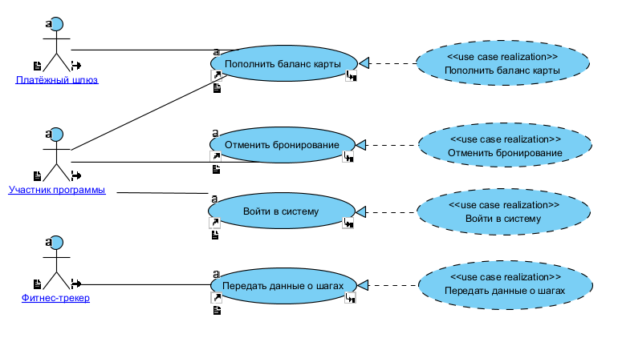
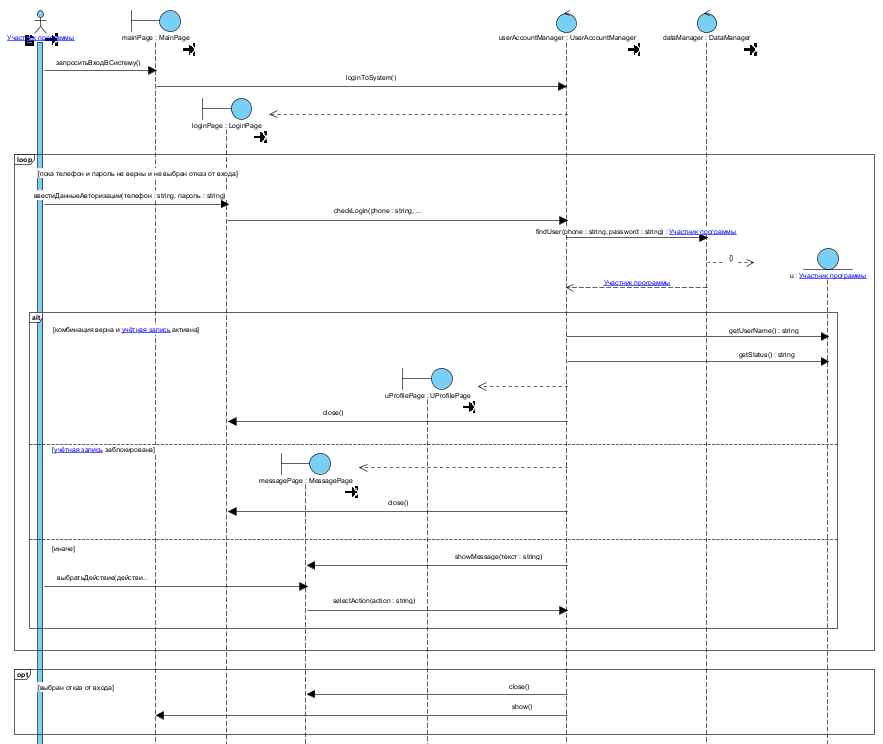
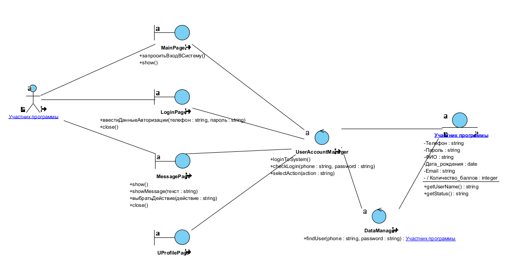
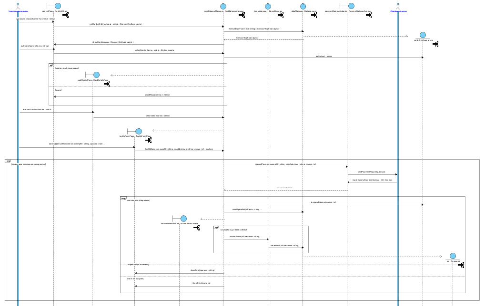
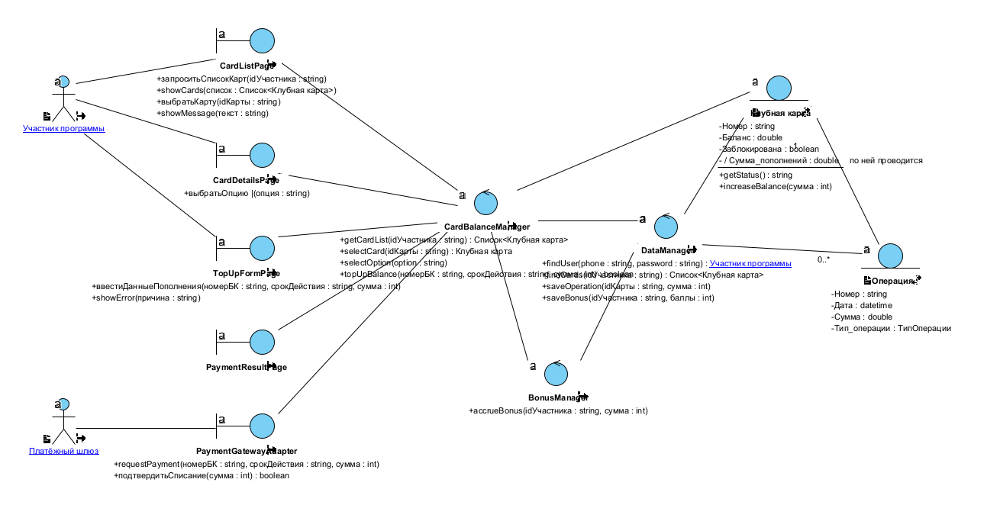

# Лабораторная работа № 6. Реализация варианта использования

| | |
|---|---|
| **Кейс** | Система управления программой лояльности сети фитнес-клубов «Fitness & Health» |
| **Учебник** | Галиаскаров Э.Г., Воробьёв А.С. «Анализ и проектирование систем с использованием UML», гл. 6 |
| **Инструменты** | Visual Paradigm 18.1 |
| **Автор** | Белянкин Артемий Русланович, БИ 3-3 |

---

## 1. Общие сведения

### 1.1. Задача работы

В ЛР5 система была представлена «чёрным ящиком»: единственный объект `Система` принимал системные события от действующих лиц и выдавал ответы. Такая модель отвечает на вопрос **что** система делает, но ничего не говорит о том, **как** она это делает.

Задача ЛР6 - заменить объект `Система` набором взаимодействующих программных объектов и показать, каким образом каждая системная операция реализуется этими объектами. Результат - детальные диаграммы последовательности и диаграммы классов VOPC.

### 1.2. Связь с предыдущими работами

| Что берём | Откуда | Как используется |
|---|---|---|
| Раскадровка, 12 экранов | ЛР5, §2 | каждый экран → граничный класс |
| Системные диаграммы последовательности | ЛР5, §3 | скелет сценария, структура фрагментов |
| 14 спецификаций системных операций | ЛР5, §4 | состав параметров программных операций |
| Модель предметной области | ЛР3 | сущностные классы и связи между ними |
| Спецификации ВИ и бизнес-правила | ЛР4 | условия ветвления, состав участвующих сущностей |

Прослеживаемость сквозная: системная операция из ЛР5 остаётся на диаграмме ЛР6 под тем же именем, но её получателем становится конкретный граничный класс, а не абстрактная «Система».

### 1.3. Объём работы

Методичка в п. 6.1 допускает выполнение «для одного или всех вариантов использования». Детальные диаграммы и VOPC построены для **двух** вариантов использования с наивысшим приоритетом:

- **UC03 «Войти в систему»** - базовый сценарий взаимодействия человека с системой;
- **UC08 «Пополнить баланс карты»** - сценарий с участием внешней системы.

Для **UC15 «Отменить бронирование»** и **UC32 «Передать данные о шагах»** в §6 приведён состав участвующих классов с распределением по ролям ECB и указанием, на какой класс попадает каждая системная операция из ЛР5. Детальные диаграммы для них не строились.

Выбор пары UC03 + UC08 не случаен: UC03 демонстрирует граничные классы-экраны (GUI), UC08 - граничный класс-API, через который работает внешняя система. Вместе они покрывают оба типа границы, описанные в п. 6.1 методички, и подтверждают различие обычных и интеграционных вариантов использования, зафиксированное в ЛР4 по материалам GetAnalyst.

---

## 2. Подготовка модели

### 2.1. Диаграмма реализации вариантов использования

В пакет `Модель вариантов использования` добавлен подчинённый пакет **«Реализация вариантов использования»**, в нём - диаграмма вариантов использования с четырьмя элементами `Collaboration`.

Каждая collaboration:

- носит то же имя, что и соответствующий вариант использования;
- связана с ним отношением **реализации** (`Realization`), направленным от collaboration к ВИ;
- имеет стереотип **`«use case realization»`** (создан вручную для элемента `Collaboration (Static)`, так как в стандартном наборе VP он отсутствует).



Пара «вариант использования + collaboration» разделяет два уровня описания. Овал ВИ отвечает за требование - что система обязана уметь. Пунктирный овал collaboration отвечает за проект - каким набором объектов это требование выполняется. Обе диаграммы (детальная последовательность и VOPC) подчинены именно collaboration, а не варианту использования.

### 2.2. Структура пакетов

```
Модель структуры
└── Модель приложения
    └── Программные классы
        ├── Система                  ← из ЛР5, 14 системных операций
        ├── 12 граничных классов     ← новые, «boundary»
        └── 6 управляющих классов    ← новые, «control»
```

Класс `Система` из ЛР5 сохранён. Он не участвует в диаграммах ЛР6, но остаётся в модели как носитель спецификаций системных операций - именно к нему привязаны операции, выявленные на предыдущем этапе.

Сущностные классы в пакет `Программные классы` **не переносились**: они остаются в модели предметной области, им лишь присвоен стереотип `«entity»`.

---

## 3. Паттерн ECB и состав программных классов

### 3.1. Правила паттерна

Разделение программных классов выполнено по паттерну **ECB** (Entity-Control-Boundary). Паттерн накладывает ограничения на то, кто с кем может обмениваться сообщениями:

| Тип классов | С кем может взаимодействовать |
|---|---|
| действующее лицо (actor) | только с граничными |
| граничные `«boundary»` | с действующими лицами и управляющими |
| управляющие `«control»` | с граничными, сущностными и другими управляющими |
| сущностные `«entity»` | с другими сущностными; получают сообщения только от управляющих |

Практический смысл ограничений: интерфейс не содержит бизнес-логики, бизнес-логика не знает об устройстве интерфейса, а данные не зависят ни от того, ни от другого. Нарушение любого из правил визуально заметно на VOPC - появляется связь, «перепрыгивающая» через слой.

### 3.2. Граничные классы `«boundary»`

Выделены по правилу «один экран раскадровки - один граничный класс» (п. 6.3 методички). Источник - §2 ЛР5.

| Класс | Экран / интерфейс | ВИ |
|---|---|---|
| `MainPage` | стартовая страница платформы | UC03 |
| `LoginPage` | форма входа | UC03 |
| `MessagePage` | страница сообщения об ошибке или блокировке | UC03, UC15 |
| `UProfilePage` | личный кабинет участника | UC03 |
| `CardListPage` | список клубных карт | UC08 |
| `CardDetailsPage` | детали выбранной карты | UC08 |
| `TopUpFormPage` | форма ввода данных банковской карты и суммы | UC08 |
| `PaymentResultPage` | результат пополнения | UC08 |
| `BookingListPage` | список бронирований | UC15 |
| `CancelConfirmPage` | подтверждение отмены брони | UC15 |
| `PaymentGatewayAdapter` | **API платёжного шлюза** | UC08 |
| `TrackerAPI` | **API фитнес-трекера** | UC32 |

Два последних класса - граничные, хотя не являются элементами интерфейса пользователя. Методичка прямо оговаривает: «если действующее лицо представляет собой другую систему, то граничные классы будут являться частью API». `Платёжный шлюз` и `Фитнес-трекер` - внешние системы, и доступ к ним инкапсулирован в этих двух классах.

### 3.3. Управляющие классы `«control»`

| Класс | Зона ответственности | ВИ |
|---|---|---|
| `UserAccountManager` | аутентификация, проверка статуса учётной записи, сессия | UC03 |
| `CardBalanceManager` | валидация суммы, проведение пополнения, фиксация операции | UC08 |
| `BookingManager` | отмена бронирования, удержание штрафа, блокировка записи | UC15 |
| `ActivityDataManager` | приём данных трекера, дедупликация по дате | UC32 |
| `BonusManager` | начисление фитнес-баллов по правилу `BR-007` | UC08, UC32 |
| `DataManager` | доступ к хранилищу: поиск, загрузка и сохранение сущностей | все |

Два решения требуют обоснования.

**`BonusManager` вынесен отдельно, а не растворён в `CardBalanceManager`.** Баллы начисляются в двух разных вариантах использования по одному и тому же бизнес-правилу `BR-007`: при пополнении свыше 5000 рублей (UC08) и при передаче данных об активности (UC32). Если логику начисления разместить внутри `CardBalanceManager` и `ActivityDataManager`, правило окажется продублированным в двух местах. Любое изменение порога или количества баллов придётся вносить дважды - классический источник рассогласования. Отдельный управляющий класс даёт единственную точку изменения.

**`DataManager` введён как отдельный слой доступа к данным.** Методичка в примере допускает прямое обращение управляющего класса к коллекции-сущности (`СписокПользователей`), но тут же оговаривает: «в реальных условиях всё будет немного сложнее… вероятнее всего, `UserAccountManager` отправит запрос экземпляру другого управляющего класса, который отвечает за доступ к данным». Мы выбрали этот вариант. Он даёт два эффекта: управляющие классы бизнес-логики не знают, откуда берутся данные, а точка подключения к хранилищу в модели ровно одна.

### 3.4. Сущностные классы `«entity»`

Новые сущностные классы не создавались. Стереотип `«entity»` присвоен существующим классам модели предметной области ЛР3:

`Участник программы` · `Клубная карта` · `Операция` · `Бронирование` · `Тренировка` · `Правило`

Классы `Клуб`, `Тренер`, `Вознаграждение`, `Вид вознаграждения` в реализации рассматриваемых вариантов использования не участвуют и стереотипа не получили.

### 3.5. Разделение системных и программных операций

Методичка вводит искусственный приём разделения уровней именованием:

- **системные операции** именуются по-русски и отражают задачу пользователя в терминах предметной области: `запроситьВходВСистему()`, `ввестиДанныеАвторизации()`, `подтвердитьСписание()`;
- **программные операции** именуются латиницей и отражают функцию, которую система выполняет, чтобы решить задачу пользователя: `loginToSystem()`, `checkLogin()`, `findUser()`.

На диаграммах ЛР6 русские имена встречаются только на стрелках, идущих от действующего лица к граничному классу. Это и есть точки входа системных событий, выявленные в ЛР5.

---

## 4. Реализация UC03 «Войти в систему»

### 4.1. Участвующие объекты

| Линия жизни | Тип | Роль в сценарии |
|---|---|---|
| `Участник программы` | actor | инициатор |
| `mainPage : MainPage` | boundary | стартовая страница |
| `loginPage : LoginPage` | boundary | форма входа, создаётся по ходу |
| `messagePage : MessagePage` | boundary | сообщение об ошибке, создаётся по ходу |
| `uProfilePage : UProfilePage` | boundary | личный кабинет, создаётся по ходу |
| `userAccountManager : UserAccountManager` | control | логика аутентификации |
| `dataManager : DataManager` | control | доступ к хранилищу |
| `u : Участник программы` | entity | найденная учётная запись |

### 4.2. Ход сценария

Участник программы открывает стартовую страницу и выбирает команду входа - это системное событие `запроситьВходВСистему()`, адресованное `mainPage`. Страница не обрабатывает его сама, а вызывает `loginToSystem()` у управляющего класса `userAccountManager`. Тот создаёт экземпляр страницы входа `loginPage` и ждёт действий пользователя.

Участник вводит телефон и пароль - второе системное событие, `ввестиДанныеАвторизации(телефон, пароль)`. Страница входа передаёт данные на проверку вызовом `checkLogin(phone, password)`. Управляющий класс не обращается к хранилищу напрямую: он вызывает `findUser(phone, password)` у `dataManager`, и уже тот при успешном поиске создаёт экземпляр `u : Участник программы` и возвращает ссылку на него.

Дальше сценарий расходится на три ветви.

**Комбинация верна и учётная запись активна.** `userAccountManager` обращается к сущности за данными - `getUserName()`, `getStatus()`, - формирует личный кабинет `uProfilePage` и закрывает страницу входа. Вариант использования завершается успешно.

**Учётная запись заблокирована.** Управляющий класс создаёт `messagePage` с сообщением о блокировке и закрывает страницу входа. Повторный ввод не предлагается - блокировка снимается администратором, а не повторной попыткой.

**Иначе.** Создаётся сообщение об ошибке с предложением выбора: повторить ввод или отказаться от входа. Выбор пользователя - третье системное событие `выбратьДействие(действие)`, которое страница передаёт управляющему классу вызовом `selectAction(action)`.

Цикл `loop` с условием `пока телефон и пароль не верны и не выбран отказ от входа` охватывает весь блок проверки, а фрагмент `opt` ниже цикла срабатывает при отказе: пользователь возвращается на стартовую страницу, сообщение закрывается.



### 4.3. Программные операции UC03

| Класс | Операция | Исходное сообщение |
|---|---|---|
| `MainPage` | `запроситьВходВСистему()` | системное событие |
| `MainPage` | `show()` | возврат на стартовую страницу |
| `LoginPage` | `ввестиДанныеАвторизации(телефон: string, пароль: string)` | системное событие |
| `LoginPage` | `close()` | закрытие формы |
| `MessagePage` | `showMessage(текст: string)` | вывод сообщения об ошибке |
| `MessagePage` | `выбратьДействие(действие: string)` | системное событие |
| `MessagePage` | `close()` | закрытие сообщения |
| `UserAccountManager` | `loginToSystem()` | запрос страницы входа |
| `UserAccountManager` | `checkLogin(phone: string, password: string): boolean` | проверка учётных данных |
| `UserAccountManager` | `selectAction(action: string)` | обработка выбора пользователя |
| `DataManager` | `findUser(phone: string, password: string): Участник программы` | поиск учётной записи |
| `Участник программы` | `getUserName(): string` | чтение атрибута |
| `Участник программы` | `getStatus(): string` | чтение атрибута |

Три системные операции ЛР5 (`запроситьВходВСистему`, `ввестиДанныеАвторизации`, `выбратьДействие`) переехали с класса `Система` на конкретные граничные классы. Это прямое следствие декомпозиции чёрного ящика: у каждого системного события теперь есть конкретный исполнитель.

### 4.4. Диаграмма VOPC для UC03



Все три типа классов ECB представлены. Проверка ограничений паттерна:

- действующее лицо связано только с `MainPage`, `LoginPage` и `MessagePage` - исключительно граничные классы;
- каждый граничный класс связан с `UserAccountManager` и ни с чем больше;
- `UserAccountManager` связан с граничными классами, с `DataManager` и с сущностью;
- сущность `Участник программы` получает сообщения только от управляющих классов.

Связей «действующее лицо - управляющий класс» или «граничный класс - сущность» на диаграмме нет.

---

## 5. Реализация UC08 «Пополнить баланс карты»

### 5.1. Участвующие объекты

| Линия жизни | Тип | Роль в сценарии |
|---|---|---|
| `Участник программы` | actor | инициатор |
| `cardListPage : CardListPage` | boundary | список клубных карт |
| `cardDetailsPage : CardDetailsPage` | boundary | детали карты, создаётся по ходу |
| `topUpFormPage : TopUpFormPage` | boundary | форма пополнения, создаётся по ходу |
| `paymentResultPage : PaymentResultPage` | boundary | результат операции, создаётся по ходу |
| `paymentGatewayAdapter : PaymentGatewayAdapter` | **boundary (API)** | доступ к платёжному шлюзу |
| `cardBalanceManager : CardBalanceManager` | control | логика пополнения |
| `bonusManager : BonusManager` | control | начисление баллов |
| `dataManager : DataManager` | control | доступ к хранилищу |
| `Платёжный шлюз` | actor | внешняя система |
| `card : Клубная карта` | entity | пополняемая карта |
| `op : Операция` | entity | запись о проведённом пополнении |

### 5.2. Ход сценария

Участник запрашивает список карт - системное событие `запроситьСписокКарт(idУчастника)`. Страница вызывает `getCardList()` у `cardBalanceManager`, тот обращается к `dataManager` методом `findCards()`, получает коллекцию экземпляров `Клубная карта` и возвращает её на отображение.

Участник выбирает карту - системное событие `выбратьКарту(idКарты)`. Управляющий класс читает статус карты вызовом `getStatus()` у сущности и ветвится: если карта не заблокирована, создаётся `cardDetailsPage`, иначе на странице списка выводится сообщение о невозможности пополнения (бизнес-правило `BR-008`).

Выбор опции «Пополнить баланс» - третье системное событие `выбратьОпцию(опция)`. Создаётся форма ввода `topUpFormPage`.

Далее начинается цикл `loop` с условием `пока сумма пополнения некорректна`. Участник вводит данные банковской карты и сумму - системное событие `ввестиДанныеПополнения(номерБК, срокДействия, сумма)`. Форма передаёт данные управляющему классу вызовом `topUpBalance()`.

Здесь начинается интеграционная часть. `cardBalanceManager` **не обращается к платёжному шлюзу напрямую** - он вызывает `requestPayment()` у граничного класса `paymentGatewayAdapter`, и уже тот отправляет запрос внешней системе методом `sendPaymentRequest()`. Ответ шлюза - системное событие `подтвердитьСписание(сумма)` - приходит обратно в адаптер, и адаптер возвращает результат управляющему классу.

При подтверждённом списании выполняется цепочка: `increaseBalance()` увеличивает баланс сущности `card`, `saveOperation()` создаёт запись `op : Операция`, формируется страница результата. Вложенный `opt` с условием `сумма больше 5000 рублей` запускает начисление баллов: `cardBalanceManager` вызывает `accrueBonus()` у `bonusManager`, тот сохраняет результат через `dataManager`.

Две ветви отказа - `в транзакции отказано` и `ответ не получен` - выводят на форму сообщение об ошибке с соответствующей причиной. Цикл позволяет повторить ввод.



### 5.3. Программные операции UC08

| Класс | Операция |
|---|---|
| `CardListPage` | `запроситьСписокКарт(idУчастника: string)` |
| `CardListPage` | `showCards(список: Список<Клубная карта>)` |
| `CardListPage` | `выбратьКарту(idКарты: string)` |
| `CardListPage` | `showMessage(текст: string)` |
| `CardDetailsPage` | `выбратьОпцию(опция: string)` |
| `TopUpFormPage` | `ввестиДанныеПополнения(номерБК: string, срокДействия: string, сумма: int)` |
| `TopUpFormPage` | `showError(причина: string)` |
| `PaymentGatewayAdapter` | `requestPayment(номерБК: string, срокДействия: string, сумма: int)` |
| `PaymentGatewayAdapter` | `подтвердитьСписание(сумма: int): boolean` |
| `CardBalanceManager` | `getCardList(idУчастника: string): Список<Клубная карта>` |
| `CardBalanceManager` | `selectCard(idКарты: string): Клубная карта` |
| `CardBalanceManager` | `selectOption(option: string)` |
| `CardBalanceManager` | `topUpBalance(номерБК: string, срокДействия: string, сумма: int): boolean` |
| `BonusManager` | `accrueBonus(idУчастника: string, сумма: int)` |
| `DataManager` | `findCards(idУчастника: string): Список<Клубная карта>` |
| `DataManager` | `saveOperation(idКарты: string, сумма: int)` |
| `DataManager` | `saveBonus(idУчастника: string, баллы: int)` |
| `Клубная карта` | `getStatus(): string` |
| `Клубная карта` | `increaseBalance(сумма: int)` |

Операция `подтвердитьСписание()` - единственная системная операция во всём отчёте, приходящая **не от человека**. Она размещена на граничном классе `PaymentGatewayAdapter`, а не на управляющем классе, и это принципиально: внешняя система обращается к API, API передаёт результат внутрь. Правило ECB «actor взаимодействует только с boundary» соблюдается для внешних систем ровно так же, как для людей.

### 5.4. Диаграмма VOPC для UC08



Ключевое наблюдение: действующее лицо `Платёжный шлюз` связано **единственной** связью - с `PaymentGatewayAdapter`. До управляющих и сущностных классов внешняя система не достаёт. Если завтра платёжный провайдер сменится, изменения затронут один класс.

Второе наблюдение касается связи `Клубная карта - Операция` с кратностью `0..*` и именем «по ней проводится». Эту связь мы на диаграмме не рисовали - Visual Paradigm подтянул её автоматически из модели предметной области ЛР3.

В этом видно различие двух слоёв. Граничные и управляющие классы связаны между собой **только потому**, что обмениваются сообщениями в рамках данного сценария: уберите сценарий - исчезнет основание для связи. Связь между сущностями существует **независимо от любого сценария**, поскольку является частью предметной области. VOPC показывает это различие наглядно, без дополнительных усилий со стороны проектировщика.

---

## 6. Состав участвующих классов для UC15 и UC32

Детальные диаграммы для этих вариантов использования не строились (см. §1.3). Ниже - распределение классов по ролям ECB и привязка системных операций ЛР5 к граничным классам.

### 6.1. UC15 «Отменить бронирование»

| Роль | Классы |
|---|---|
| actor | `Участник программы` (AC02) |
| boundary | `BookingListPage`, `CancelConfirmPage`, `MessagePage` |
| control | `BookingManager`, `DataManager` |
| entity | `Бронирование`, `Тренировка`, `Клубная карта`, `Участник программы` |

| Системная операция ЛР5 | Граничный класс-получатель |
|---|---|
| `запроситьСписокБронирований(idУчастника)` | `BookingListPage` |
| `запроситьОтменуБронирования(idБронирования)` | `BookingListPage` |
| `подтвердитьОтмену(idБронирования, согласие)` | `CancelConfirmPage` |

Сущность `Тренировка` нужна для проверки времени начала (`BR-011`: отмена невозможна после начала тренировки), `Клубная карта` - для удержания штрафа и проверки достаточности средств (`BR-012`, `BR-013`).

Структурно UC15 повторяет UC08: список → выбор элемента → подтверждение → ветвление по результату. Отдельной детальной диаграммы он не получил именно поэтому - новых проектных решений относительно UC08 он не добавляет.

### 6.2. UC32 «Передать данные о шагах»

| Роль | Классы |
|---|---|
| actor | `Фитнес-трекер` (AC06) |
| boundary | `TrackerAPI` |
| control | `ActivityDataManager`, `BonusManager`, `DataManager` |
| entity | `Участник программы`, `Правило` |

| Системная операция ЛР5 | Граничный класс-получатель |
|---|---|
| `принятьУведомлениеОДанных(idПодключения, дата)` | `TrackerAPI` |
| `подтвердитьАвторизацию(idПодключения, токен)` | `TrackerAPI` |
| `принятьДанныеОШагах(idПодключения, дата, шаги)` | `TrackerAPI` |

Это единственный из четырёх вариантов использования, где **нет ни одного экранного граничного класса**. Весь внешний контур - один класс `TrackerAPI`. Результат работы сценария не отображается пользователю немедленно: баллы начисляются, и участник увидит их при следующем входе в личный кабинет.

Управляющий класс `BonusManager` здесь тот же самый, что в UC08. Это и есть практическое подтверждение решения из §3.3: правило `BR-007` описано в модели один раз и переиспользуется двумя независимыми сценариями.

---

## 7. Соответствие чек-листу главы 6

| Пункт чек-листа | Где выполнено | Статус |
|---|---|---|
| Создан пакет «Модель приложения» | §2.2 | ✅ |
| Создан пакет «Программные классы» | §2.2 | ✅ |
| Все новые программные классы размещены в пакете «Программные классы» | §3.2, §3.3 - 12 boundary и 6 control | ✅ |
| На диаграмме последовательности и (или) VOPC присутствуют объекты всех трёх типов классов ECB | §4.1, §4.4, §5.1, §5.4 | ✅ |
| Actor обменивается сообщениями только с граничными классами | §4.4, §5.4 - проверено на обеих VOPC | ✅ |
| Граничные классы получают сообщения от actor и передают их только управляющим | §4.2, §5.2 | ✅ |
| Организацией, координацией и реализацией бизнес-логики занимаются управляющие классы | §3.3 - шесть control-классов с разделёнными зонами ответственности | ✅ |
| Данные предоставляются и сохраняются сущностными классами | §3.4, §5.2 - `getStatus`, `increaseBalance`, создание `op` | ✅ |
| Диаграмма последовательности демонстрирует логичный и непротиворечивый сценарий | §4.2, §5.2 - структура фрагментов совпадает с системными диаграммами ЛР5 | ✅ |

Дополнительно выполнены требования п. 6.2 методички, не вошедшие в чек-лист:

| Требование | Где выполнено |
|---|---|
| Пакет «Реализация вариантов использования» | §2.1 |
| Collaboration для каждого реализуемого ВИ | §2.1 |
| Отношение реализации между collaboration и ВИ | §2.1 |
| Стереотип `«use case realization»` | §2.1 |
| Префикс VOPC в именах диаграмм классов | §4.4, §5.4 |

