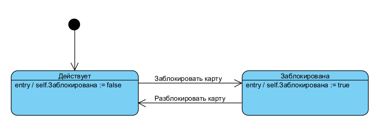
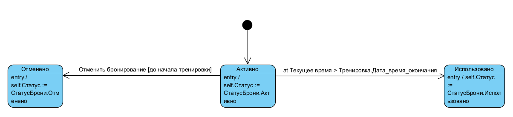
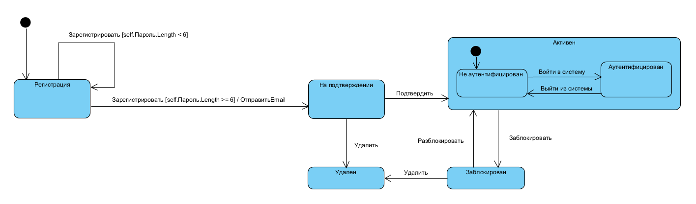
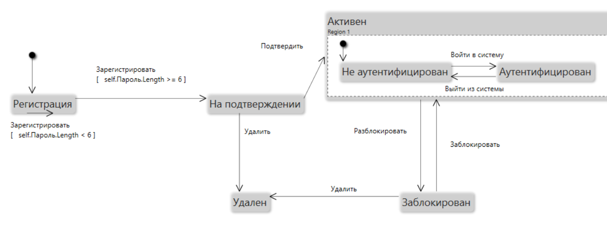
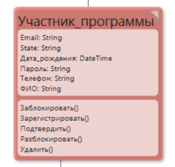
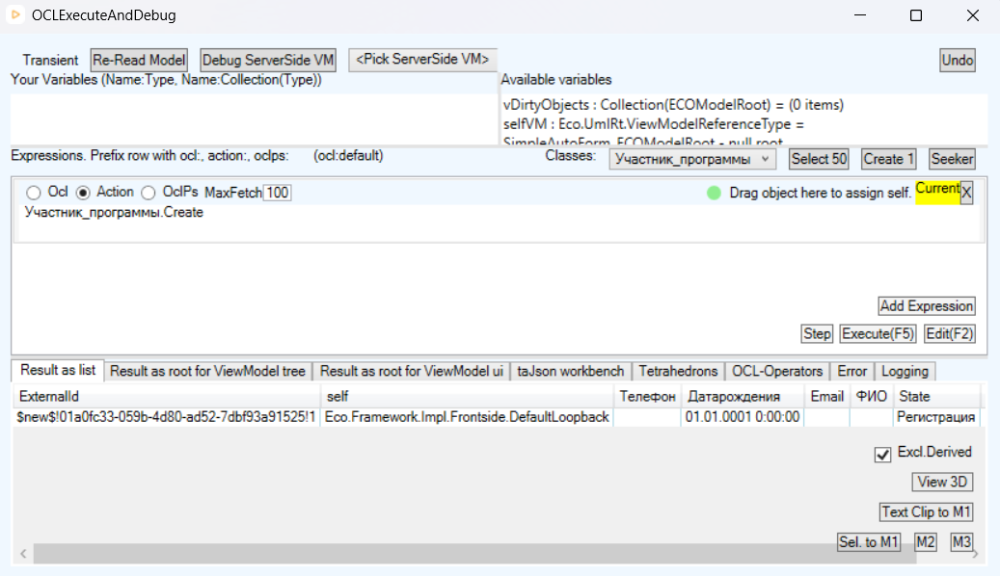
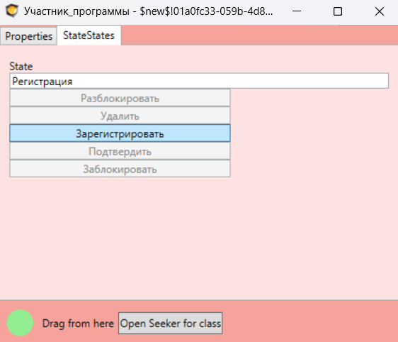
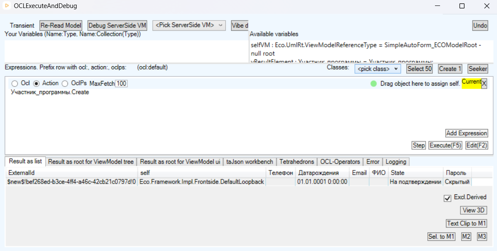
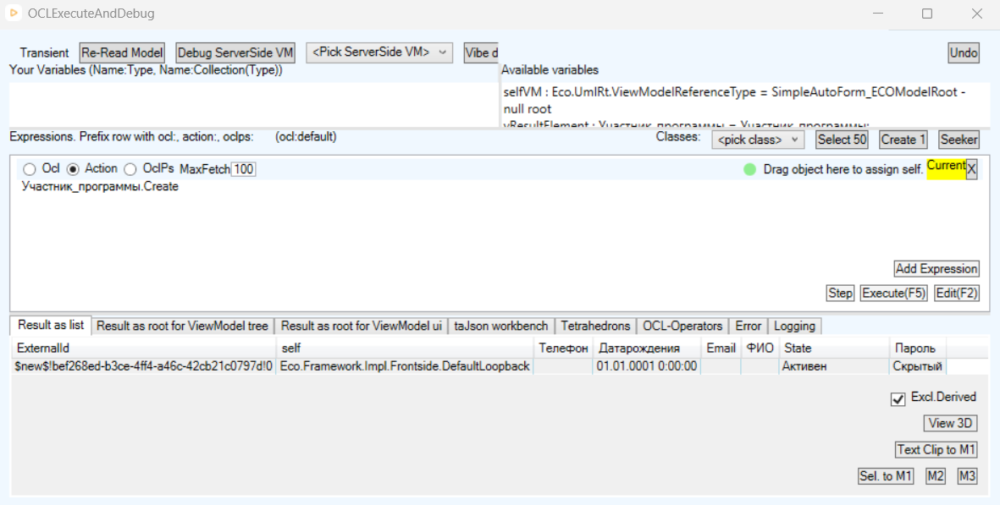
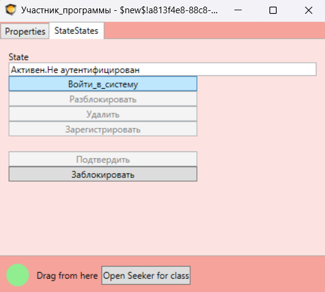

# Лабораторная работа № 7. Разработка модели состояний

| | |
|---|---|
| **Кейс** | Система управления программой лояльности сети фитнес-клубов «Fitness & Health» |
| **Учебник** | Галиаскаров Э.Г., Воробьёв А.С. «Анализ и проектирование систем с использованием UML», гл. 7 |
| **Инструменты** | Visual Paradigm 18.1 |
| **Автор** | Белянкин Артемий Русланович, БИ 3-3 |

---

## 1. Общие сведения

### 1.1. Задача работы

Предыдущие работы описывали поведение системы снаружи и между объектами: диаграммы вариантов использования — взаимодействие с действующими лицами, диаграммы последовательности — обмен сообщениями между объектами, диаграммы деятельности — логику отдельных сценариев.

ЛР7 смотрит на поведение с четвёртой стороны: как меняется **один объект** на протяжении своей жизни. Инструмент — диаграмма автомата (state machine diagram), граф, узлами которого являются состояния, а дугами — переходы, вызванные событиями.

Задание состоит из двух частей:

1. перечислить все объекты, для которых возможно изменение значений атрибутов в ходе жизненного цикла;
2. для одного или всех таких объектов построить диаграмму автомата.

### 1.2. Объём работы

Диаграммы автоматов построены для **трёх** объектов. Выбор сделан так, чтобы каждая диаграмма демонстрировала свой приём моделирования и они не дублировали друг друга:

| Объект | Что демонстрирует |
|---|---|
| `Клубная карта` | базовый автомат, entry-активности, изменяющие атрибут |
| `Бронирование` | временно́е событие (Time event), три исхода из одного состояния |
| `Участник программы` | сторожевые условия, переход в себя, составное состояние с регионом |

Автомат «Участник программы» дополнительно построен в **MDriven Designer** и проверен в интерактивном прототипе (§6) — это требование §7.4 методички и последний пункт чек-листа главы 7.

### 1.3. Связь с предыдущими работами

| Что берём | Откуда | Как используется |
|---|---|---|
| Классы и их атрибуты | ЛР3 | источник состояний: состояние = значение атрибута |
| Перечисление `СтатусБрони` | ЛР3 | имена состояний автомата «Бронирование» |
| OCL-ограничения | ЛР3 | сторожевые условия на переходах |
| Бизнес-правила `BR-008`, `BR-011` | ЛР4 | условия и ограничения переходов |
| Системные операции | ЛР5 | события, вызывающие переходы |
| Модель `fitness.modlr` | ЛР3 | основа для интерактивной проверки |

---

## 2. Объекты-кандидаты

Методичка в §7.2 предлагает два источника кандидатов: явные указания в описании задачи и последовательный анализ состава атрибутов каждого класса. Применены оба.

| Класс | Меняются ли значения атрибутов в жизненном цикле | Кандидат | Обоснование |
|---|---|---|---|
| **Участник программы** | да: учётная запись проходит регистрацию, подтверждение, может быть заблокирована и удалена | ✅ построен | UC01, UC03, `BR-002` |
| **Клубная карта** | да: атрибут `Заблокирована`, а также баланс | ✅ построен | кейс: участник «может блокировать свои потерянные карты»; `BR-008` |
| **Бронирование** | да: атрибут `Статус` типа `СтатусБрони` | ✅ построен | UC15, `BR-011` |
| **Правило** | да: правило действует или не действует в зависимости от дат периода | кандидат, диаграмма не строилась | атрибуты начала и конца периода действия |
| **Вознаграждение** | да: начислено → использовано | кандидат, диаграмма не строилась | жизненный цикл описан в кейсе |
| **Тренировка** | да: запланирована, проведена, отменена | кандидат, диаграмма не строилась | расписание клуба |
| **Операция** | нет | не кандидат | запись о финансовой операции неизменяема после создания: она фиксирует факт, а не состояние |
| **Клуб** | нет | не кандидат | атрибуты (адрес, часы работы) меняются редактированием справочника, а не событиями жизненного цикла объекта |
| **Тренер** | нет | не кандидат | то же |
| **Вид вознаграждения** | нет | не кандидат | справочный класс |

Последние четыре строки требуют пояснения, потому что формально их атрибуты тоже могут измениться. Разница в природе изменения. У `Клуба` можно исправить телефон, но это редактирование данных, а не смена состояния: объект не ведёт себя по-разному до и после правки, никакие действия не становятся доступны или недоступны. У `Бронирования` же смена статуса меняет само поведение — отменённое бронирование нельзя отменить повторно, использованное не даёт права на вход.

Это и есть критерий отбора, сформулированный в чек-листе ЛР7: «выделены значимые характеристики объекта, которые меняются при переходе из одного состояния в другое».

**Уточнений модели ЛР3 не потребовалось.** Все три построенных автомата опираются на уже существующие атрибуты: `Заблокирована : boolean` у клубной карты и `Статус : СтатусБрони` у бронирования. Это косвенно подтверждает качество модели классов — состояния были предусмотрены ещё на этапе уточнения.

---

## 3. Автомат объекта «Клубная карта»



### 3.1. Состав

| Состояние | entry-активность |
|---|---|
| `Действует` | `self.Заблокирована := false` |
| `Заблокирована` | `self.Заблокирована := true` |

| Переход | Событие |
|---|---|
| ● → `Действует` | — |
| `Действует` → `Заблокирована` | `Заблокировать карту` |
| `Заблокирована` → `Действует` | `Разблокировать карту` |

### 3.2. Пояснения

Начальный переход не имеет события: он срабатывает в момент создания объекта. Новая карта всегда рождается действующей — это зафиксировано не комментарием, а самой структурой автомата.

Entry-активности делают связь состояния и атрибута явной. Состояние `Заблокирована` — не абстрактное понятие, а конкретное значение `true` в поле `Заблокирована`. Любой разработчик, читающий эту диаграмму, понимает, что именно он должен записать в базу.

Переходы двусторонние: заблокированную карту можно разблокировать. Конечного состояния нет — карта живёт, пока существует учётная запись участника.

**Что сознательно не вошло в автомат.** У клубной карты есть второй набор состояний, связанный с балансом: нулевой, положительный. Он не добавлен в эту диаграмму, потому что ортогонален блокировке — карта может быть заблокирована при любом балансе, и наоборот. Смешивать два независимых измерения в одном автомате значило бы получить четыре состояния вместо двух, из которых половина описывает не поведение, а комбинации. Чек-лист главы 7 прямо предостерегает: «убедитесь, что при описании состояний объекта вы находитесь на нужном уровне абстракции». Корректный способ показать оба измерения — ортогональные регионы, но для учебной задачи это избыточно.

---

## 4. Автомат объекта «Бронирование»



### 4.1. Состав

| Состояние | entry-активность |
|---|---|
| `Активно` | `self.Статус := СтатусБрони.Активно` |
| `Использовано` | `self.Статус := СтатусБрони.Использовано` |
| `Отменено` | `self.Статус := СтатусБрони.Отменено` |

| Переход | Событие | Сторожевое условие |
|---|---|---|
| ● → `Активно` | — | — |
| `Активно` → `Отменено` | `Отменить бронирование` | `до начала тренировки` |
| `Активно` → `Использовано` | **Time event** `Тренировка завершена`<br>`when: Текущее время > Тренировка.Дата_время_окончания` | — |

### 4.2. Пояснения

**Имена состояний не придуманы, а взяты из модели.** Класс `Бронирование` имеет атрибут `Статус` типа `СтатусБрони` — перечисления, созданного в ЛР3 с литералами `Активно`, `Использовано`, `Отменено`. Состояния автомата совпадают с литералами один в один. Если бы мы ввели четвёртое состояние, модель разошлась бы сама с собой: автомат утверждал бы одно, перечисление допускало бы другое.

**Переход в `Использовано` происходит по временно́му событию.** Никто не нажимает кнопку «использовать бронирование». Бронирование считается использованным, когда заканчивается тренировка, на которую оно оформлено. Такие переходы вызываются не действием пользователя, а наступлением момента времени, и в UML для них существует отдельный вид события — Time event со спецификацией `when`. Visual Paradigm отображает его на диаграмме префиксом `at`.

**Сторожевое условие обязательно.** Из состояния `Активно` выходят два перехода. Без условия они оказались бы конкурирующими: автомат не смог бы определить, куда идти, если момент окончания тренировки наступил одновременно с попыткой отмены. Условие `до начала тренировки` на переходе отмены разводит их по времени и реализует бизнес-правило `BR-011` — отменить бронирование после начала тренировки нельзя.

**Обратных переходов нет намеренно.** Отменённое бронирование не восстанавливается, использованное не отменяется. Оба состояния тупиковые, и это корректно отражает жизненный цикл: после завершения истории объект существует как запись, но его поведение больше не меняется.

---

## 5. Автомат объекта «Участник программы»



### 5.1. Состав

| Состояние | Смысл |
|---|---|
| `Регистрация` | пользователь инициировал регистрацию, данные ещё не прошли проверку |
| `На подтверждении` | данные приняты, ожидается подтверждение по e-mail |
| `Активен` | **составное**, учётная запись работает |
| `Заблокирован` | доступ в систему закрыт |
| `Удален` | объект помечен на удаление |

Внутри составного состояния `Активен` — вложенный автомат из двух состояний: `Не аутентифицирован` (начальное) и `Аутентифицирован`.

| Переход | Событие | Сторожевое условие | Действие |
|---|---|---|---|
| ● → `Регистрация` | — | — | — |
| `Регистрация` → `Регистрация` | `Зарегистрировать` | `self.Пароль.Length < 6` | — |
| `Регистрация` → `На подтверждении` | `Зарегистрировать` | `self.Пароль.Length >= 6` | `ОтправитьEmail` |
| `На подтверждении` → `Активен` | `Подтвердить` | — | — |
| `На подтверждении` → `Удален` | `Удалить` | — | — |
| `Активен` → `Заблокирован` | `Заблокировать` | — | — |
| `Заблокирован` → `Активен` | `Разблокировать` | — | — |
| `Заблокирован` → `Удален` | `Удалить` | — | — |
| `Не аутентифицирован` → `Аутентифицирован` | `Войти в систему` | — | — |
| `Аутентифицирован` → `Не аутентифицирован` | `Выйти из системы` | — | — |

### 5.2. Переход в себя и взаимоисключающие условия

Из состояния `Регистрация` выходят два перехода **с одним и тем же событием** `Зарегистрировать`. Различаются они сторожевыми условиями, и условия подобраны так, чтобы покрывать все случаи и не пересекаться: `< 6` и `>= 6`.

Смысл конструкции в следующем. Пользователь нажимает «Зарегистрироваться». Система проверяет пароль. Если он короче шести символов, объект возвращается в то же состояние — пользователь остаётся на форме регистрации и может исправить данные. Если пароль корректен, объект уходит дальше, и на переходе выполняется действие: отправка письма с инструкцией подтверждения.

Без взаимоисключающих условий автомат оказался бы недетерминированным. Это прямое требование чек-листа: «убедитесь, из одного состояния все переходы взаимоисключающие».

Условие опирается на OCL-ограничение длины пароля, заданное для класса `Участник программы` ещё в ЛР3. Диаграмма автомата не вводит новое правило, а использует существующее — в этом и состоит согласованность модели.

### 5.3. Зачем состояние «Активен» сделано составным

Вход и выход из системы не меняют состояние учётной записи: она как была активной, так и остаётся. Но внутри активного состояния есть собственная жизнь — пользователь то аутентифицирован, то нет.

Если вынести `Аутентифицирован` и `Не аутентифицирован` на верхний уровень, получится неверная модель: переходы `Заблокировать` и `Разблокировать` пришлось бы дублировать для каждого из них, а из диаграммы следовало бы, что заблокировать можно только неаутентифицированного пользователя.

Вложенный автомат решает это одним приёмом. Внешние переходы работают с `Активен` целиком, независимо от того, в каком внутреннем состоянии находится объект. Администратор может заблокировать пользователя в любой момент — и когда тот в системе, и когда нет.

---

## 6. Интерактивная проверка автомата в MDriven Designer

Методичка в §7.4 предлагает не только построить автомат, но и убедиться, что он действительно работает. Для этого автомат «Участник программы» воспроизведён в MDriven Designer поверх модели классов `fitness.modlr` из ЛР3 и проверен в прототипе.



### 6.1. Генерация атрибута и методов

После команды `Add StateMachine` и расстановки событий MDriven сам изменил структуру класса: добавил атрибут `State : String` и пять методов по именам событий — `Заблокировать()`, `Зарегистрировать()`, `Подтвердить()`, `Разблокировать()`, `Удалить()`.



Это важный признак: автомат не нарисован рядом с классом, а **привязан** к нему. Состояние стало полноценным атрибутом, события — вызываемыми операциями.

### 6.2. Протокол проверки

Прототип запущен в режиме `None` (Transient) — объекты живут в памяти, модель не изменяется.

**Шаг 1. Создание объекта.** Создан экземпляр `Участник_программы`. В колонке `State` — значение `Регистрация`. Начальный переход сработал автоматически, без каких-либо действий.



**Шаг 2. Проверка сторожевого условия.** Не заполняя пароль, нажата кнопка `Зарегистрировать`. Состояние осталось `Регистрация` — сработал переход в себя по условию `self.Пароль.Length < 6`.



Этот скриншот содержит два результата. Первый — условие действительно не пропускает объект дальше. Второй виден в наборе кнопок: `Разблокировать`, `Удалить`, `Подтвердить` и `Заблокировать` погашены, активна только `Зарегистрировать`. MDriven сам отключает события, которых нет на переходах из текущего состояния. Это наглядное подтверждение взаимоисключающих переходов: из состояния `Регистрация` физически некуда уйти другим путём.

**Шаг 3. Корректный пароль.** В поле `Пароль` введено значение из девяти символов, событие `Зарегистрировать` послано повторно. Объект перешёл в `На подтверждении`, набор доступных кнопок изменился — стали активны `Подтвердить` и `Удалить`.



**Шаг 4. Основной путь.** Последовательно выполнены `Подтвердить` → `Активен`, `Заблокировать` → `Заблокирован`, `Разблокировать` → `Активен`. Все переходы отработали в соответствии с диаграммой.



**Шаг 5. Вложенный автомат.** После добавления региона в состояние `Активен` объект, доведённый до этого состояния, показывает значение `Активен.Не аутентифицирован` — составное состояние отображается через точку. Стала доступна кнопка `Войти_в_систему`, после нажатия — `Выйти из системы`.



Запись через точку — лучшая иллюстрация смысла составного состояния: объект одновременно находится во внешнем состоянии и во вложенном, и оба влияют на набор доступных событий.

### 6.3. Нотационная модель против исполняемой

При первом запуске прототип отказался выполнять переход `Регистрация` → `На подтверждении`. Отладчик выдал:

```
"ОтправитьEmail" is not a type name
```

Причина в различии назначения двух инструментов. В Visual Paradigm поле `Effect` — это **подпись** на диаграмме, которую читает человек: «при переходе отправляется письмо». В MDriven то же поле — **исполняемое OCL-выражение**, которое среда должна вычислить. Текст `ОтправитьEmail` не является ни функцией, ни типом, выражение завершилось ошибкой, и MDriven откатил переход целиком.

Решение: в модели MDriven поле `Effect` очищено, в Visual Paradigm действие оставлено как есть.

Вывод, который стоит зафиксировать. Нотационная модель допускает действие, названное человеческим языком, — она адресована читателю и описывает замысел. Исполняемая модель требует выражения, которое среда умеет вычислить, — она адресована машине. Одна и та же диаграмма, корректная в первом смысле, может быть неработоспособной во втором. Прототипирование как раз и обнаруживает такие расхождения: на бумаге автомат выглядел правильным и после ошибки выглядит точно так же.

Побочный эффект этой проверки — закрыт долг ЛР3. Там OCL-ограничения были написаны, но ни разу не выполнялись на реальных данных. Здесь ограничение длины пароля сработало как сторожевое условие на живом объекте.

---

## 7. Спецификации состояний

Формат по §7.5 методички. Приведены для автомата «Участник программы» как наиболее сложного.

### Состояние: Регистрация

**Описание:** пользователь инициировал процесс регистрации, объект создан, данные ещё не прошли проверку.

**События, приводящие к данному состоянию:** создание объекта (начальный переход); повторная неудачная попытка регистрации.

**Условия, характеризующие данное состояние:** пока не заполнены все обязательные поля; пока пароль не соответствует требованиям, заданным OCL-ограничением в ЛР3.

**События, возможные в данном состоянии:**

| Событие | Отклик | Следующее состояние |
|---|---|---|
| `Зарегистрировать [self.Пароль.Length < 6]` | — | `Регистрация` |
| `Зарегистрировать [self.Пароль.Length >= 6]` | `ОтправитьEmail` | `На подтверждении` |

### Состояние: На подтверждении

**Описание:** данные приняты, объект ожидает подтверждения активации учётной записи.

**События, приводящие к данному состоянию:** `Зарегистрировать` с корректным паролем.

**Условия, характеризующие данное состояние:** пока не получено подтверждение активации и не истекли сутки с момента регистрации.

**События, возможные в данном состоянии:**

| Событие | Отклик | Следующее состояние |
|---|---|---|
| `Подтвердить` | — | `Активен` |
| `Удалить` | — | `Удален` |

### Состояние: Активен

**Описание:** составное состояние. Пользователю доступны все действия согласно его правам. Внутри состояния объект находится в одном из двух вложенных: `Аутентифицирован` или `Не аутентифицирован`.

**События, приводящие к данному состоянию:** `Подтвердить`; `Разблокировать`.

**Условия, характеризующие данное состояние:** учётная запись не заблокирована и не удалена.

**События, возможные в данном состоянии:**

| Событие | Отклик | Следующее состояние |
|---|---|---|
| `Заблокировать` | — | `Заблокирован` |
| `Войти в систему` | — | `Активен.Аутентифицирован` |
| `Выйти из системы` | — | `Активен.Не аутентифицирован` |

### Состояние: Заблокирован

**Описание:** пользователю запрещён доступ в систему, учётная запись сохранена.

**События, приводящие к данному состоянию:** `Заблокировать`.

**Условия, характеризующие данное состояние:** учётная запись помечена как заблокированная.

**События, возможные в данном состоянии:**

| Событие | Отклик | Следующее состояние |
|---|---|---|
| `Разблокировать` | — | `Активен` |
| `Удалить` | — | `Удален` |

### Состояние: Удален

**Описание:** объект помечен на удаление, никакие действия невозможны.

**События, приводящие к данному состоянию:** `Удалить`.

**Условия, характеризующие данное состояние:** объект помечен на удаление.

**События, возможные в данном состоянии:** нет.

---

## 8. Соответствие чек-листу главы 7

| Пункт чек-листа | Где выполнено | Статус |
|---|---|---|
| При описании состояний объекта вы находитесь на нужном уровне абстракции | §3.2 — обоснование отказа от смешивания блокировки и баланса в одном автомате; §4.2 — состояния совпадают с литералами перечисления ЛР3 | ✅ |
| Выделены все свойства (атрибуты и поведение), характеризующие данное состояние | §7 — спецификации пяти состояний с описанием, условиями и таблицами событий | ✅ |
| Выделены значимые характеристики объекта, которые меняются при переходе | §2 — критерий отбора кандидатов; §3.1, §4.1 — entry-активности, явно задающие значения атрибутов | ✅ |
| Диаграмма автомата построена с позиции одного выбранного объекта | §3, §4, §5 — три независимые диаграммы, каждая подчинена своему классу | ✅ |
| Из одного состояния все переходы взаимоисключающие | §4.2 — условие `до начала тренировки`; §5.2 — пара `< 6` / `>= 6`; §6.2 шаг 2 — подтверждено прототипом | ✅ |
| При использовании прототипа поведение объекта демонстрирует ту логику, что вы проектировали | §6.2 — протокол из пяти шагов со скриншотами | ✅ |

Дополнительно выполнен пункт 1 задания, не вошедший в чек-лист:

| Требование | Где выполнено |
|---|---|
| Перечислить все объекты, для которых возможно изменение значений атрибутов в ходе жизненного цикла | §2 — таблица по всем десяти классам модели с обоснованием включения и исключения |

---

## 10. Итог семестрового цикла

ЛР7 — заключительная работа. Семь лабораторных образуют связную последовательность, где каждая опирается на предыдущие:

| ЛР | Результат | Что дала следующим работам |
|---|---|---|
| 1 | Концептуальная модель классов | словарь предметной области |
| 2 | 33 варианта использования, 7 действующих лиц | перечень функций системы |
| 3 | Атрибуты, типы, перечисления, OCL | источник состояний и условий для ЛР7 |
| 4 | Спецификации ВИ, 16 бизнес-правил, диаграммы деятельности | условия ветвления для ЛР5 и ЛР7 |
| 5 | Раскадровка, системные диаграммы последовательности, 14 системных операций | граничные классы и события для ЛР6 |
| 6 | Программные классы по ECB, детальные диаграммы, VOPC | распределение системных операций по исполнителям |
| 7 | Модель состояний, проверенная в прототипе | — |

Модель прошла путь от текстового описания задачи до диаграмм, по которым можно писать код, и была проверена на исполнимость в двух точках: OCL-запросами в ЛР3 и автоматом в прототипе MDriven в ЛР7.
